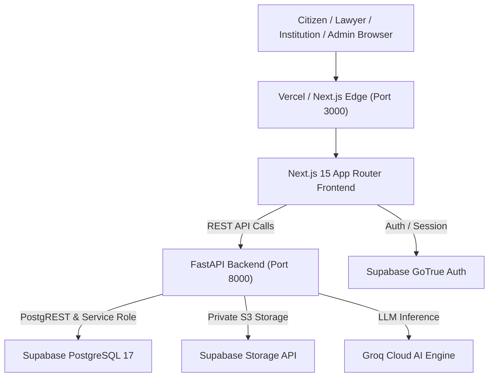

# NyayPath Production Deployment Guide

This guide provides step-by-step instructions for deploying the **NyayPath** unified legal assistance platform into production staging and live environments.

---

## Architecture Overview



---

## 1. Database Deployment & Migration Runbook

The NyayPath database is built on PostgreSQL 17 with Row Level Security (RLS) enabled on all application tables. All migrations are strictly chronological and idempotent.

### 1.1 Migration Execution Order

Migrations are located in `supabase/migrations/` and must be executed in this exact order:

1. `20261031000001_create_campus_cases.sql` — Core campus grievances schema, tracking key hashing, audit logs.
2. `20261031000002_security_remediation.sql` — PBKDF2 officer credentials, student UUID validation, RLS policies.
3. `20261031000003_rate_limit_security_fix.sql` — Persistent serverless rate limiting table and fail-secure policies.
4. `20261031000004_core_platform_schema.sql` — Parent cases table, UGC categories, automatic sync triggers, audit actor mappings.
5. `20261101000001_notifications_schema.sql` — Notifications table, event types, recipient index, unread counter.
6. `20261101000002_notifications_hardening.sql` — Notification immutability triggers, least-privilege role grants.
7. `20261101000003_lawyer_connect_schema.sql` — Lawyer profiles, verification states, consultation requests, case access grants.
8. `20261101000004_messaging_and_meetings_schema.sql` — Secure conversations, messages, private attachments, meeting scheduler.
9. `20261102000001_concurrent_meeting_exclusion.sql` — `btree_gist` extension, GiST exclusion constraint (`exclude_overlapping_confirmed_meetings`) on `consultation_meetings`.
10. `20261102000002_platform_admin_schema.sql` — Platform admins table, audit logging, system metrics functions.

### 1.2 Remote Migration Execution

```bash
# Push migrations to linked Supabase remote project
supabase db push
```

*Or via PostgreSQL client (e.g. psql / pgAdmin):*
```bash
psql -h <SUPABASE_DB_HOST> -p 5432 -U postgres -d postgres -f supabase/migrations/20261031000001_create_campus_cases.sql
# ... execute sequentially through 20261102000002_platform_admin_schema.sql
```

### 1.3 Schema Verification Query
Execute the following verification query to ensure all 26 schema objects are active:
```sql
SELECT table_name, table_type 
FROM information_schema.tables 
WHERE table_schema = 'public' 
ORDER BY table_name;
```

---

## 2. Supabase Storage Setup

Two dedicated, private storage buckets are required.

### 2.1 Bucket Creation
Create the following private storage buckets in the Supabase Dashboard or via SQL:

```sql
INSERT INTO storage.buckets (id, name, public, file_size_limit, allowed_mime_types)
VALUES 
  ('case-documents', 'case-documents', false, 10485760, ARRAY['application/pdf', 'image/png', 'image/jpeg']),
  ('message-attachments', 'message-attachments', false, 10485760, ARRAY['application/pdf', 'image/png', 'image/jpeg', 'image/webp'])
ON CONFLICT (id) DO UPDATE SET public = false;
```

### 2.2 Storage Security Rules
- **Public access:** Disabled (`public = false`). Direct public URLs must fail with 400/404.
- **Signed URLs:** Time-To-Live (TTL) is strictly enforced to **300 seconds** (5 minutes).
- **Access control:** All downloads must route through authorized FastAPI endpoints (`/api/campus-proctor/document-url` or `/api/conversations/attachments/{id}/url`), which verify institutional roles, committee assignments, or active lawyer case sharing.

---

## 3. Supabase Auth (GoTrue) Configuration

In the Supabase Dashboard under **Authentication > URL Configuration**:

### 3.1 Site URL & Redirect URLs
- **Site URL:** `https://nyaypath.gov.in` (or production domain)
- **Additional Redirect URLs:**
  - `https://nyaypath.gov.in/**`
  - `https://nyaypath.gov.in/dashboard`
  - `https://nyaypath.gov.in/messages`
  - `https://nyaypath.gov.in/lawyer/dashboard`
  - `https://nyaypath.gov.in/admin/dashboard`
  - `https://nyaypath.gov.in/institution/dashboard`
  - `http://localhost:3000/**` (for local development only)

### 3.2 Security Settings
- **Email Confirmations:** Recommended enabled for production signups.
- **JWT Expiry Limit:** 3600 seconds (1 hour). Refresh tokens automatically handle rotation.
- **Disable Anonymous Logins:** Ensure anonymous auth does not bypass database RLS.

---

## 4. FastAPI Backend Deployment

The backend is built with FastAPI and runs on Python 3.11+.

### 4.1 Production Environment Variables

Configure the following variables in your hosting environment (e.g. AWS ECS, GCP Cloud Run, DigitalOcean App Platform, or Linux systemd):

```env
ENVIRONMENT=production
NODE_ENV=production
SUPABASE_URL=https://<your-project>.supabase.co
SUPABASE_PUBLISHABLE_KEY=<your-anon-publishable-key>
SUPABASE_SECRET_KEY=<your-service-role-secret-key>
SUPABASE_JWT_SECRET=<your-supabase-jwt-secret>
JWT_SECRET=<minimum-32-character-independent-application-secret>
CASE_TRACKING_HMAC_KEY=<minimum-32-character-tracking-salt>
CRON_SECRET=<secure-random-token-for-automation>
GROQ_API_KEY=<your-groq-api-key>
BACKEND_URL=https://api.nyaypath.gov.in
CORS_ORIGINS=https://nyaypath.gov.in,https://app.nyaypath.gov.in
```

### 4.2 Running with Gunicorn / Uvicorn Workers

```bash
pip install -r requirements.txt
pip install gunicorn uvicorn[standard]

# Run with 4 Uvicorn worker processes behind Gunicorn
gunicorn -w 4 -k uvicorn.workers.UvicornWorker api.index:app --bind 0.0.0.0:8000 --timeout 60
```

### 4.3 Production Startup Checks
When `ENVIRONMENT=production`:
- If `JWT_SECRET` is unset or default, the backend halts immediately with exit code 1.
- If `CASE_TRACKING_HMAC_KEY` is unset or default, the backend halts immediately with exit code 1.
- If `SUPABASE_URL` or `SUPABASE_SECRET_KEY` is unreachable, all database queries fail closed (HTTP 503).
- Offline mock storage is disabled; missing files strictly return HTTP 404/503.
- Production diagnostic endpoint `/api/debug/supabase` is disabled (HTTP 404).

---

## 5. Next.js Frontend Deployment

The frontend is built on Next.js 15 (App Router).

### 5.1 Production Environment Variables

Configure the following build-time and runtime variables in your frontend host (e.g., Vercel, Netlify, or Node.js Docker):

```env
NEXT_PUBLIC_SUPABASE_URL=https://<your-project>.supabase.co
NEXT_PUBLIC_SUPABASE_ANON_KEY=<your-anon-publishable-key>
NEXT_PUBLIC_API_URL=https://api.nyaypath.gov.in
```

### 5.2 Build Command & Output

```bash
# Verify TypeScript types
npx tsc --noEmit

# Compile production bundle
npm run build

# Start Next.js production server (Port 3000)
npm run start
```

---

## 6. Preflight Smoke Test Checklist

Execute these verifications immediately following a staging or production release:

- [ ] **Health Endpoint:** `GET https://api.nyaypath.gov.in/` returns `200 OK` with `{"status": "ok", "database_connected": true}`.
- [ ] **Diagnostics Disabled:** `GET https://api.nyaypath.gov.in/api/debug/supabase` returns `404 Not Found`.
- [ ] **CORS Restriction:** Preflight `OPTIONS https://api.nyaypath.gov.in/api/citizen/cases` from unauthorized origin returns zero wildcard `*` headers.
- [ ] **Rate Limiting:** Sending 10 rapid failed logins to `/api/campus-proctor/auth/login` returns `429 Too Many Requests` with `Retry-After: 900`.
- [ ] **Storage Privacy:** Attempting to fetch a document from Supabase storage directly without signed URL returns `403 Forbidden` / `400 Bad Request`.
- [ ] **Platform Admin Verification:** Attempting platform admin operations without an active record in `public.platform_admins` returns `403 Forbidden`.
- [ ] **Meeting Conflict:** Attempting to book two overlapping meetings with the same advocate returns `400 Bad Request`.
- [ ] **Frontend Routes:** All 41 pages render cleanly without unhandled CSR bailouts.

