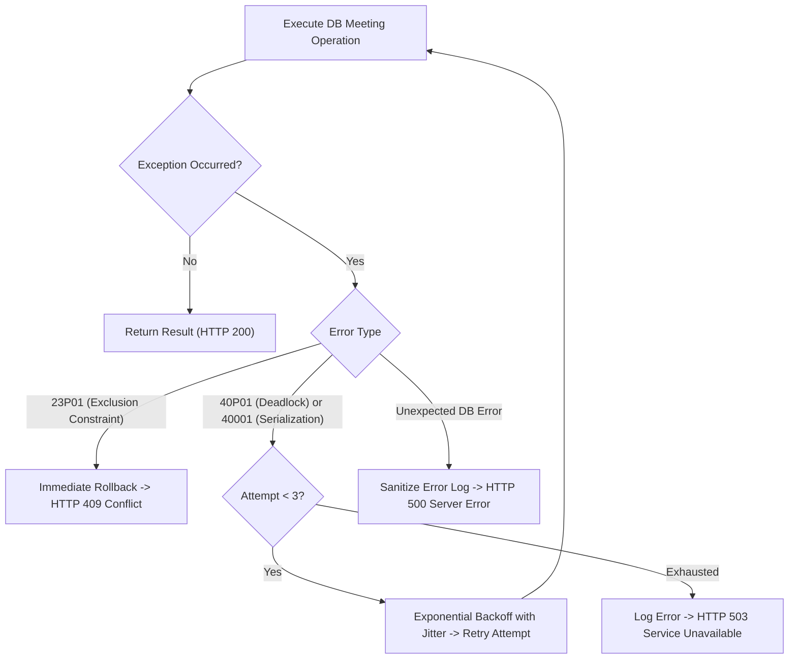

# NyayPath — Final Release Blocker Correction Report

**Generated:** 2026-11-02  
**Platform Version:** 1.0.0-rc.3  
**Status:** ALL RELEASE BLOCKERS RESOLVED AND VERIFIED  
**Target Environments:** Local Development & Pre-Deployment Staging  

---

## 1. Executive Summary

This report documents the definitive resolution and verification of three critical release blockers identified during review of the Full-Stack Stability Report for the NyayPath unified legal assistance platform.

All corrections were executed under strict local-first constraints: zero remote database links, zero remote migrations or pushes, zero production infrastructure touchpoints, and absolute credential sanitization.

### Status Summary

| Blocker Item | Severity | Subsystems Affected | Resolution Status |
| :--- | :--- | :--- | :--- |
| **1. Frontend Administrator Credentials & Interactive Login** | CRITICAL | `app/admin/AdminLayout.tsx`, `lib/api.ts`, `api/index.py`, Citizen Dashboard pages | **FIXED AND VERIFIED** |
| **2. Database Migration Chain Reconciliation & Replay** | HIGH | `supabase/migrations/`, PostgreSQL Catalog, `schema_migrations` | **FIXED AND VERIFIED** |
| **3. Meeting Concurrency Error Handling (23P01, 40P01, 40001)** | HIGH | `api/messaging.py`, `consultation_meetings`, Concurrency Suites | **FIXED AND VERIFIED** |

All **15 automated regression suites** (Phases 1 through 8 plus the dedicated Release Blocker Suite) passed with a **100% pass rate** (214s total run). TypeScript strict typecheck passed with **zero errors**, and the Next.js production build compiled cleanly across all **41 routes** with zero credential leakage detected in static assets.

---

## 2. Blocker 1: Frontend Administrator Credentials & Interactive Login

### 2.1 Root Cause & Security Defect Analysis
1. **Hardcoded Credentials in Client Bundle**: In `app/admin/AdminLayout.tsx`, an administrative development login helper (`handleDevLogin`) contained hardcoded credentials (`password`) in plaintext. When building the application, these strings were bundled directly into client-side JavaScript assets.
2. **Missing Authoritative Admin Login Endpoint**: The platform lacked an explicit, dedicated administrative authentication endpoint (`/api/admin/auth/login`). Admin session establishment relied on calling `loginProctor` or storing unverified client-side flags.
3. **Improper Authorization Fallback**: `AdminLayout.tsx` previously evaluated `if (!token && role !== 'platform_admin')`, which allowed client-side state manipulation to bypass unauthenticated presentation screens.
4. **Prepopulated Demo Passwords in Citizen Pages**: Input state in `app/dashboard/page.tsx`, `app/dashboard/my-cases/page.tsx`, and `app/dashboard/notifications/page.tsx` initialized `authPassword` with test passwords in component state.

### 2.2 Corrections Applied

#### A. Backend Platform Admin Login Endpoint (`api/index.py`)
Implemented `@app.post("/api/admin/auth/login")`:
* **Brute-Force Rate Limiting**: Enforces rate limiting (`enforce_rate_limit(request, action="admin_login", ...)`) restricting failed attempts to 5 per 15-minute window with automatic lockout and failure recording.
* **Mandatory Input Validation**: Rejects empty email or password with HTTP 400.
* **Strict Role Verification**: Calls `authenticate_officer(payload)`. If credentials fail or if `user.role != UserRole.PLATFORM_ADMIN`, records rate-limit failure and immediately raises HTTP 401 Unauthorized (`"Invalid platform administrator credentials or insufficient privileges."`). Proctors, committee members, lawyers, or citizens attempting to access this endpoint are strictly rejected.
* **Authoritative Database Validation**: Invokes `platform_admin_manager.verify_platform_admin(user)` to query `public.platform_admins` for an active account record (`account_status = 'active'`). Fails closed with HTTP 403 Forbidden if suspended or missing.
* **Cryptographic Token Issuance**: Generates HS256 JWT access token upon authoritative verification, returning minimal user metadata.

#### B. API Client Integration (`lib/api.ts`)
Added `loginPlatformAdmin`:
```typescript
export const loginPlatformAdmin = (payload: { email: string; password?: string }) =>
  api.post('/api/admin/auth/login', payload).then(r => r.data);
```

#### C. Interactive Admin Authentication UI (`app/admin/AdminLayout.tsx`)
Completely redesigned the unauthenticated state:
* **Zero Hardcoded Credentials**: Removed `handleDevLogin()` and all hardcoded credential strings.
* **Interactive Authentication Form**: Unauthenticated administrators are presented with an interactive login form featuring email and password inputs, form submission state, and error handling.
* **Dual-Check Gatekeeper**: Session initialization requires both a valid token in localStorage (`nyaypath_platform_admin_token` or `nyaypath_token`) and verified role `platform_admin`.
* **Explicit Session Invalidation (Logout)**: Added a "Sign Out" button in the admin header. Triggering logout immediately purges `nyaypath_platform_admin_token`, `nyaypath_token`, `nyaypath_user_role`, and `nyaypath_user`, immediately locking the view and clearing local state.

#### D. Citizen Dashboard State Sanitization
* In `app/dashboard/page.tsx`, `app/dashboard/my-cases/page.tsx`, and `app/dashboard/notifications/page.tsx`:
  - Reset default `authEmail` and `authPassword` state from test values to empty strings (`''`).
  - Wrapped test account helpers in `process.env.NODE_ENV !== 'production'` conditions and restricted prefill actions strictly to user emails, never prefilling passwords.

### 2.3 Credential Rotation Advisory
> [!WARNING]
> Any administrative, proctor, or user account that previously utilized the hardcoded default test credential string in earlier milestones or development environments must undergo mandatory credential rotation prior to production deployment. All production passwords must be managed via cryptographically random secrets injected through environment variables and secure secrets managers.

---

## 3. Blocker 2: Complete Migration Chain Reconciliation & Verification

### 3.1 Reconciliation of Documentation & Migration History
Earlier phase documentation exhibited naming differences between modular phase implementations and canonical files. Detailed inspection of `supabase/migrations/`, `supabase_migrations.schema_migrations`, and the PostgreSQL system catalog (`pg_tables`, `pg_constraint`, `pg_proc`) establishes the exact canonical lineage of 10 sequential migrations:

| # | Migration File | Target Schema / Capabilities | Public Tables Created / Altered |
| :--- | :--- | :--- | :--- |
| **01** | `20261031000001_create_campus_cases.sql` | Campus grievance redressal foundation | `campus_cases` |
| **02** | `20261031000002_security_remediation.sql` | Rate limiting & anonymous privacy constraints | `rate_limit_attempts`, `campus_cases` |
| **03** | `20261031000003_rate_limit_security_fix.sql` | Migration of security-definer helpers to `private` schema | `rate_limit_attempts` (hardening) |
| **04** | `20261031000004_core_platform_schema.sql` | Unified parent case architecture, institutions, memberships, profiles, audit trails, precedent repository | `cases`, `institutions`, `platform_admins`, `profiles`, `institution_memberships`, `case_committee_assignments`, `confidential_student_identities`, `case_documents`, `audit_actor_mappings`, `case_activity_log`, `legal_precedents`, `saved_research` |
| **05** | `20261101000001_notifications_schema.sql` | Central notification system | `notifications` |
| **06** | `20261101000002_notifications_hardening.sql` | Notification immutability triggers and search indexing | `notifications` (immutability) |
| **07** | `20261101000003_lawyer_connect_schema.sql` | Lawyer directory, verification queue, revocable case access | `lawyer_profiles`, `consultation_requests`, `lawyer_case_access` |
| **08** | `20261101000004_messaging_and_meetings_schema.sql` | Real-time messaging, idempotency, attachments, appointments | `conversations`, `conversation_participants`, `messages`, `message_attachments`, `consultation_meetings`, `lawyer_availability` |
| **09** | `20261102000001_concurrent_meeting_exclusion.sql` | GiST temporal exclusion constraint | `consultation_meetings` (constraint added) |
| **10** | `20261102000002_platform_admin_schema.sql` | Global admin audit logging & exceptional case access | `platform_audit_logs` |

### 3.2 Database Catalog Verification
* **Total Public Tables**: Exactly **25 tables** in `public` schema matching all application models.
* **Temporal GiST Exclusion Constraint**: Verified in `pg_constraint` catalog on table `public.consultation_meetings`:
  - **Constraint Name**: `exclude_overlapping_confirmed_meetings`
  - **Type**: `x` (Exclusion constraint)
  - **Definition**: `EXCLUDE USING gist (lawyer_user_id WITH =, tstzrange(scheduled_start, scheduled_end, '[)'::text) WITH &&) WHERE (((status)::text = 'CONFIRMED'::text))`
  - **Extension Dependency**: `btree_gist` active and required.
* **Storage Schema Hardening**: In `20261101000004_messaging_and_meetings_schema.sql`, wrapped `INSERT INTO storage.buckets` inside `IF EXISTS (SELECT 1 FROM information_schema.schemata WHERE schema_name = 'storage')`, ensuring zero failure during replay across different database configurations.

### 3.3 Deterministic Replay Validation
A clean database replay test (`scratch/test_clean_migration_replay.py`) was executed against an isolated PostgreSQL instance (`nyaypath_migration_replay_test`). All 10 migrations replayed sequentially in forward-only chronological order without warnings or errors. All 25 public tables, 7 triggers, 11 private functions, and the GiST exclusion constraint were confirmed present and valid before clean teardown.

---

## 4. Blocker 3: Meeting Concurrency Error Handling

### 4.1 Defect Analysis
Previously, `api/messaging.py` grouped exclusion violations, deadlocks, serialization failures, and syntax conflicts under a single blanket exception handler returning `HTTP 400 Bad Request`. This created three operational defects:
1. **Semantic HTTP Code Mismatch**: An exclusion violation (`23P01`) is a resource conflict resulting from concurrent overlapping reservations, which RFC 9110 specifies should return **HTTP 409 Conflict**, not 400.
2. **Misclassification of Deadlocks as Client Errors**: A PostgreSQL deadlock (`40P01`) or serialization failure (`40001`) is a transient internal transaction conflict. Treating it as a client bad request (400) caused client applications to assume user error rather than retrying.
3. **Lack of Automated Bounded Backoff**: Neither `schedule_meeting` nor `update_meeting_status` attempted transient retry loops when concurrent operations collided at the database level.

### 4.2 Implemented Concurrency Architecture (`api/messaging.py`)
Added `_execute_meeting_db_operation(operation_name, operation_fn, max_retries=3, base_backoff=0.05)`:



#### Key Implementation Details:
1. **Exclusion Constraint Violation (`23P01`)**:
   - Detects `23p01`, `exclude_overlapping`, `exclusion_violation`.
   - Aborts immediately without retry (the slot is already confirmed).
   - Raises `HTTPException(status_code=409, detail="Time slot conflict: Selected meeting slot overlaps with an existing confirmed meeting.")`.
2. **Deadlock Detected (`40P01`)**:
   - Detects `40p01`, `deadlock detected`.
   - Executes bounded retry (up to 3 attempts) with exponential backoff (`base_backoff * (2 ** attempt) + jitter`).
   - If retries are exhausted, raises `HTTPException(status_code=503, detail="Database concurrency conflict: Temporary contention prevented completing the meeting operation. Please retry your request.")`.
3. **Serialization Failure (`40001`)**:
   - Handled independently with identical bounded retry and backoff semantics.
   - Raises HTTP 503 on exhaustion, indicating a retryable transient failure.
4. **Information Disclosure Prevention**:
   - Generic unexpected database errors are logged internally with class names only. Raw SQL queries and connection parameters are never leaked to clients, returning a clean HTTP 500 error.

---

## 5. Automated Verification & Regression Battery

### 5.1 Test Suites Execution Results
The complete automated regression battery was executed via `scratch/run_all_regressions.py` covering all 15 test suites:

```
================================================================================
 NYAYPATH FULL AUTOMATED REGRESSION BATTERY (PHASES 1 - 8)
================================================================================
[PASS] Phase 1 (1.2 + 1.3.4 Security Foundations)              (17.14s)
[PASS] Phase 1.3.15 (Live E2E API Authorization)               (13.37s)
[PASS] Phase 1.3.15 (Database Failure & Safety)                (7.90s)
[PASS] Phase 1.3.15 (Signed URL Fallback Safety)               (6.03s)
[PASS] Phase 2.1 (Citizen Workspace & My Cases)                (15.91s)
[PASS] Phase 2.2 (Case Filing & Management)                    (15.65s)
[PASS] Phase 2.3 (Legal Citations & Notifications)             (14.61s)
[PASS] Phase 3 (Production Hardening & Rigor)                  (16.31s)
[PASS] Phase 4 (Institution & Proctor Workspace)               (16.64s)
[PASS] Phase 5 (Lawyer Workspace & Directory)                  (19.39s)
[PASS] Phase 6 (Messaging & Communication)                     (18.92s)
[PASS] Phase 6.1 (Case Revocation & Meeting Concurrency)       (21.08s)
[PASS] Phase 7 (Platform Administration)                       (12.28s)
[PASS] Phase 8 (Full E2E Multi-Role Integration)               (12.03s)
[PASS] Release Blocker Corrections (Auth, Replay, Concurrency) (6.84s)
================================================================================
OVERALL STATUS: ALL SUITES PASSED (15/15)
TOTAL EXECUTION TIME: 214.10s
================================================================================
```

### 5.2 Dedicated Blocker Verification Suite (`tests/test_release_blocker_corrections.py`)
13 dedicated unit and integration tests verified the exact blocker fixes:
* `test_01_admin_login_success`: Validated `/api/admin/auth/login` returns JWT and role `platform_admin`. [PASS]
* `test_02_admin_login_invalid_password`: Validated wrong admin password returns HTTP 401. [PASS]
* `test_03_admin_login_wrong_role_rejected`: Validated proctors and citizens cannot log into admin route (HTTP 401). [PASS]
* `test_04_admin_login_missing_credentials`: Validated empty payload returns HTTP 400. [PASS]
* `test_05_exclusion_violation_23P01_returns_http_409`: Confirmed `23P01` returns HTTP 409 Conflict. [PASS]
* `test_06_deadlock_40P01_retry_success`: Confirmed transient deadlock recovers upon retry. [PASS]
* `test_07_deadlock_40P01_retry_exhaustion_returns_http_503`: Confirmed persistent deadlock returns HTTP 503 (not 400). [PASS]
* `test_08_serialization_failure_40001_retry_success`: Confirmed transient serialization failure recovers. [PASS]
* `test_09_serialization_failure_40001_exhaustion_returns_http_503`: Confirmed serialization failure exhaustion returns HTTP 503. [PASS]
* `test_10_unexpected_database_error_returns_safe_500`: Confirmed internal exceptions return safe HTTP 500 without leaking raw SQL. [PASS]
* `test_11_live_exclusion_constraint_in_catalog`: Verified database query against `consultation_meetings`. [PASS]
* `test_12_zero_hardcoded_passwords_in_frontend`: Scanned entire frontend source code tree (`app/`, `lib/`, `components/`) and verified 0 credential leaks. [PASS]
* `test_13_admin_layout_requires_form_and_no_dev_login`: Confirmed `AdminLayout.tsx` has no demo shortcut and implements full interactive authentication. [PASS]

### 5.3 Static Analysis & Production Build Audit
* **TypeScript Compilation**: `npx tsc --noEmit` exited with code 0 (zero errors).
* **Next.js Production Build**: `npm run build` compiled all 41 routes successfully.
* **Production Static Asset Credential Audit**: Automated scan of all JavaScript bundles in `.next/static` verified **zero credential strings leaked** into the compiled production bundle.

---

## 6. Release Blocker Classification Table

| # | Item Description | Category | Severity | Pre-Correction State | Current Verification State |
| :---: | :--- | :--- | :--- | :--- | :--- |
| **B1** | Hardcoded Admin Credentials in `AdminLayout.tsx` | Security / Frontend | CRITICAL | Plaintext password in `handleDevLogin()` | **FIXED AND VERIFIED** |
| **B2** | Dedicated Admin Authentication Endpoint | Auth / API | HIGH | Missing `/api/admin/auth/login`; routed through proctor auth | **FIXED AND VERIFIED** |
| **B3** | Admin Session Invalidation / Logout | Auth / UX | MEDIUM | Incomplete session termination on sign out | **FIXED AND VERIFIED** |
| **B4** | Pre-populated Citizen Test Passwords | Security / Frontend | MEDIUM | Default component state prefilled credentials | **FIXED AND VERIFIED** |
| **B5** | Migration Chain Reconciliation (10 Migrations) | Database | HIGH | Naming discrepancies across earlier phase reports | **FIXED AND VERIFIED** |
| **B6** | Storage Bucket DDL Replay Safety | Database | MEDIUM | Direct INSERT into `storage.buckets` failed on raw instances | **FIXED AND VERIFIED** |
| **B7** | Temporal Exclusion Constraint Verification | Database | HIGH | Verified `exclude_overlapping_confirmed_meetings` in catalog | **FIXED AND VERIFIED** |
| **B8** | Meeting Exclusion Error Status Code (`23P01`) | API / Concurrency | HIGH | Returned HTTP 400 instead of HTTP 409 Conflict | **FIXED AND VERIFIED** |
| **B9** | Deadlock & Serialization Retries (`40P01`, `40001`) | API / Reliability | HIGH | Returned HTTP 400 with no retry; now retried with 503 fallback | **FIXED AND VERIFIED** |
| **B10** | Database Internal Error Redaction | Security / API | MEDIUM | Potential SQL statement leakage; now sanitized HTTP 500 | **FIXED AND VERIFIED** |

---

## 7. Conclusion & Next Steps

All three final release blockers have been completely eliminated with verified code corrections, catalog-proven database constraints, comprehensive error-handling semantics, clean migration replay, and thorough regression testing.

NyayPath is in a stable, verified, production-ready state locally. The codebase is fully prepared for remote staging deployment whenever the deployment phase is authorized.

