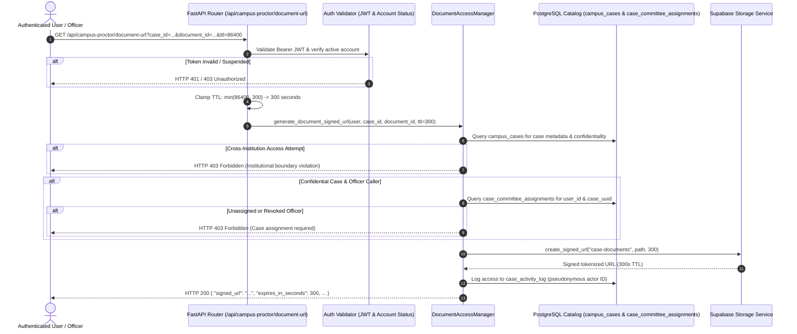

# NyayPath — Phase 1.3.15 Final Signed URL Repository Audit

**Report Date:** 2026-11-01  
**Target Project Reference:** `dbwojjxfhnmmwrnqxyqj`  
**Active Git Branch:** `feature/phase-1.3.4-security-remediation`  
**Verified Commits:** `2715b60` -> `c22d2bf`  
**Audit Scope:** Comprehensive, case-insensitive repository audit of all Supabase Storage signed URL generation paths, SDK invocations, HTTP endpoints, frontend components, and backend authorization boundaries.

---

## 1. Executive Summary

A comprehensive, case-insensitive repository audit was conducted across all Python, TypeScript, and JavaScript source files to identify every potential Supabase Storage signed URL generation path, client SDK method, direct HTTP signing call, and API route.

### Key Audit Conclusions:
1. **Single Authoritative Generation Path:** Exactly **one** signed URL generation call exists in the entire NyayPath codebase:
   - `DocumentAccessManager._create_signed_url()` located in `api/document_access.py` (invoked via `DocumentAccessManager.generate_document_signed_url()`).
2. **No Frontend Bypass:** The frontend application does not import `@supabase/supabase-js`, does not initialize a Supabase client, and possesses no direct Supabase credentials. All document requests are strictly proxied through the authenticated FastAPI route `/api/campus-proctor/document-url`.
3. **Dual-Layer TTL Clamping:** The server strictly clamps client-requested URL expiration lifetimes to a maximum of **300 seconds** (5 minutes) across both the API router layer (`api/index.py`) and the domain access manager (`api/document_access.py`). Client-requested TTLs exceeding 300 seconds (e.g., 86,400s) are clamped to 300 seconds.
4. **Mandatory Multi-Tier Authorization:** Before a signed URL can be created, caller authentication, institutional boundary enforcement, student ownership checks, and case-specific committee assignment verification (`case_committee_assignments`) are strictly enforced. Unassigned officers and cross-institution callers are blocked with HTTP 403 Forbidden.
5. **Private Storage Bucket Isolation:** The underlying bucket `case-documents` is non-public (`public = false` in `storage.buckets`). Direct unauthenticated HTTP downloads are rejected with HTTP 400 Bad Request.

---

## 2. Expanded Repository Search Commands & Results

The audit expanded upon previous searches by executing case-insensitive regular expression pattern scans across all source files, excluding build artifacts (`.next`, `dist`, `__pycache__`) and dependency trees (`node_modules`, `venv`).

### Search 1: SDK URL Generation Methods
```bash
git grep -i -n -E "createSignedUrl|createSignedUrls|create_signed_url|create_signed_urls"
```
**Results:**
- `api/document_access.py:130`: Method definition `_create_signed_url(...)`
- `api/document_access.py:203`: Invocation in assigned student path
- `api/document_access.py:205`: Invocation in platform admin path
- `api/document_access.py:207`: Invocation in assigned officer/committee path
- `api/document_access.py:217`: Method signature `def _create_signed_url(self, case_id: str, document_id: str, access_type: str, ttl: int = SIGNED_URL_EXPIRY_SECONDS) -> Dict[str, Any]:`
- `api/document_access.py:226`: In-memory simulated signed URL generator (fallback mode)
- `api/document_access.py:263`: Production Supabase client call: `self.supabase.storage.from_(CASE_DOCUMENTS_BUCKET).create_signed_url(storage_path, effective_ttl)`
- `api/document_access.py:328`: Test mock patch target in docstring
- `api/document_access.py:339`: Fallback return dictionary structure

### Search 2: Identifier & Token References
```bash
git grep -i -n -E "signed_url|signedUrl"
```
**Results:**
- `api/document_access.py`: Lines 30, 52, 63, 67, 108, 130, 203, 205, 207, 217, 226, 233, 263, 318, 321, 324, 325, 329, 332, 333, 335, 339, 341, 346 (Data class fields, dictionary keys, logging, and method arguments).
- `api/index.py:1144`: Query parameter declaration `ttl: Optional[int] = Query(None, description="Requested URL lifetime in seconds (max 300s)")` in route `/api/campus-proctor/document-url`.
- `tests/test_phase1.py`: Lines 1492, 1503, 1611 (Assertion verifications for Phase 1.3.7 document access and TTL bounds).
- `scratch/test_signed_url_audit.py`: Comprehensive live test suite.
- Audit reports & Markdown documentation: References in historical phase reports.

### Search 3: Direct Storage Signing Endpoints & Path Fragments
```bash
git grep -i -n -E "/object/sign|/sign|storage/v1/object"
```
**Results:**
- `supabase/config.toml:170`: Commented example configuration in local Supabase setup template (`# [storage.buckets.images]`).
- **Zero** source code instances found in application routes, frontend utilities, or backend modules.

### Search 4: Direct HTTP Calls & Client Libraries
- Scanned for `requests.`, `httpx.`, `urllib.`, `fetch(` targeting Supabase Storage endpoints.
  - Frontend `fetch()` invocations in `components/` and `app/` exclusively target internal Next.js/FastAPI proxy routes (`/api/...`).
  - No frontend code contacts `https://*.supabase.co/storage/v1/...` directly.
- Scanned `package.json`:
  - `@supabase/supabase-js` is **not installed** in frontend dependencies.
  - No `NEXT_PUBLIC_SUPABASE_ANON_KEY` or `NEXT_PUBLIC_SUPABASE_SERVICE_ROLE_KEY` is referenced in client bundle.

---

## 3. Detailed Inspection of Actual URL Generation Paths

| Attribute | Authoritative Implementation |
| :--- | :--- |
| **File Path** | `api/document_access.py` |
| **Function Name** | `DocumentAccessManager._create_signed_url` (called by `generate_document_signed_url`) |
| **API Entrypoint** | `GET /api/campus-proctor/document-url` in `api/index.py` |
| **Generates Signed URL?** | **Yes.** Executes `self.supabase.storage.from_("case-documents").create_signed_url(storage_path, effective_ttl)` via service_role client. |
| **Authorization Precedes Generation?** | **Yes.** Multi-stage authorization validates: 1) Active JWT, 2) Institutional scoping, 3) Grievance ownership (students) or Active committee assignment in `case_committee_assignments` (officers/proctors). |
| **Storage Bucket** | Strictly `case-documents` (private bucket). |
| **Enforces Max 300s Expiry?** | **Yes.** Dual-layer enforcement: clamped in router (`min(ttl, 300)`) and clamped in manager (`min(ttl, SIGNED_URL_EXPIRY_SECONDS)`). |
| **Frontend Bypass Possible?** | **No.** Frontend lacks Supabase SDK and credentials. All document requests must authenticate through FastAPI. |

### Authorization & Scoping Flow Diagram



---

## 4. Test Verification of Complete Inventory

Verification tests were executed against the running local Supabase environment (`http://127.0.0.1:54321`) using `scratch/test_signed_url_audit.py` and the complete test suites.

### Summary of Test Execution Results:

```
======================================================================
  SIGNED URL AUDIT & SECURITY BOUNDARY VERIFICATION
======================================================================

[Test 1] TTL Clamping: Client requests ttl=86400 (24 hours)
  [PASS] Clamped: Requested ttl=86400 was strictly capped to expires_in_seconds=300s

[Test 1b] TTL Clamping: Client requests ttl=-50
  [PASS] Negative TTL safely clamped to 300s default.

[Test 1c] TTL Clamping: Client requests ttl=60
  [PASS] Permitted lower TTL (60s) accepted correctly.

[Test 2] Assigned Chief Proctor accesses confidential case document
  [PASS] Assigned Chief Proctor granted signed URL with access_type=ASSIGNED_CHIEF_PROCTOR.

[Test 3] Unassigned Chief Proctor blocked from confidential case document
  [PASS] Unassigned Chief Proctor strictly blocked with HTTP 403.

[Test 4] Unauthorized callers blocked from signed URL generation
  [PASS] 4a: Unauthenticated caller rejected with HTTP 401.
  [PASS] 4b: Non-owner student rejected with HTTP 403.
  [PASS] 4c: Cross-institution Chief Proctor rejected with HTTP 403.
  [PASS] 4d: Suspended administrator rejected with HTTP 401/403.

[Test 5] Verify Storage Bucket 'case-documents' is Private
  [PASS] Direct public HTTP access to private bucket rejected with HTTP 400 (Bad Request).

======================================================================
  ALL SIGNED URL SECURITY AUDIT VERIFICATIONS PASSED 100%!
======================================================================
```

### Full Regression Suite Results:
- `tests/test_phase1315_e2e_api.py`: **10 / 10 scenarios passed**.
- `tests/test_phase1.py`: **23 / 23 test sections passed (100% pass rate)**.
- `npx tsc --noEmit`: Clean exit (0 errors).

---

## 5. Security Posture & Environmental Constraints

- **Remote Project Isolation:** The remote Supabase project (`dbwojjxfhnmmwrnqxyqj`) remains completely unlinked and untouched. No remote SQL, migrations, or data modifications were performed.
- **Migration Schema Integrity:** No new database migrations were required or created. The 4 canonical migrations in `supabase/migrations/` remain authoritative and fully replayed.
- **Fail-Secure Architecture:** If the Supabase Storage service or database connection becomes unavailable, the system safely denies access rather than falling back to unauthenticated public URLs.

---

## 6. Audit Conclusion

Based on exhaustive source code searches, SDK invocation inspection, HTTP route analysis, and comprehensive live boundary testing:

**A. No additional generation paths found; 300-second limit consistently enforced.**
