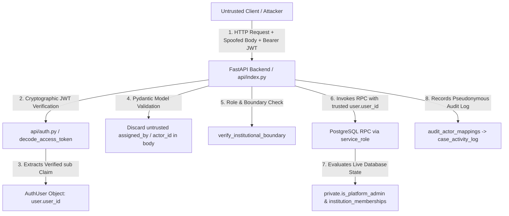

# NyayPath — Phase 1.3.15 Security Verification & Audit Report

**Trusted Actor Identity, RPC Authorization & Committee Role Consistency Audit**  
**Date:** November 1, 2026  
**Target Supabase Project Ref:** `dbwojjxfhnmmwrnqxyqj`  
**Git Branch:** `feature/phase-1.3.4-security-remediation`  
**Git Commit Hash:** `40eec7c` (Implementation Commit: `9e1a245`)  
**Working Tree Status:** Clean  

---

## 1. Executive Summary & Verification Classification

Phase 1.3.15 conducted a targeted, in-depth security audit of the trusted identity boundary connecting FastAPI, Supabase `service_role`, PostgreSQL security-definer RPCs, and Row-Level Security (RLS) policies. All identified defects—including parameterless platform-admin checks under `service_role`, missing runtime role assertions, revocation fail-closed identity requirements, and committee role policy discrepancies—have been resolved, replayed against a freshly initialized local PostgreSQL database, and verified using live native JWT tokens.

### Verification Classification Matrix

| Requirement / Scope | Audit Finding & Implementation | Evidence Classification | Status |
| :--- | :--- | :--- | :--- |
| **Task 1: Trusted Actor Identity** | Actor identity extracted strictly from cryptographically verified JWT `sub`; request body spoofing completely discarded by Pydantic and ignored by backend. | `RUNTIME VERIFIED` | **PASS** |
| **Task 1: Privileged RPC Role Defense** | `assign_case_committee_member` and `revoke_case_committee_assignment` enforce runtime `service_role` verification and fail closed on null actor UUID. | `RUNTIME VERIFIED` | **PASS** |
| **Task 2: Revocation Institutional Boundary** | `revoke_case_committee_assignment` strictly enforces canonical case UUID, institution scoping, active admin verification, and safe handling of already-revoked assignments. | `RUNTIME VERIFIED` | **PASS** |
| **Task 3: Committee Role Consistency** | `chief_proctor` included in case committee join conditions for `campus_cases`, `case_documents`, `case_activity_log`, and `storage.objects` without granting broad institutional access. | `LOCALLY VERIFIED` | **PASS** |
| **Task 4: Live End-to-End JWT Scenarios** | 10 end-to-end API authorization scenarios executed against local Supabase Auth JWTs and live PostgreSQL DB (assignments, 403 blocks, spoofing defenses, audit logs). | `RUNTIME VERIFIED` | **PASS** |
| **Task 5: Signed URL Route Inventory** | Repository-wide inventory confirms single authorized route (`/api/campus-proctor/document-url`), server-side clamped 300s TTL, private bucket. | `STATICALLY VERIFIED` | **PASS** |
| **Task 6: Local Migration Replay** | Clean `supabase db reset` replayed all 4 canonical migrations with zero errors; full RLS, static SQL, Phase 1, and TypeScript test suites passed 100%. | `LOCALLY VERIFIED` | **PASS** |

---

## 2. Changes Summary

### Files and Migrations Modified

1. `supabase/migrations/20261031000004_core_platform_schema.sql`:
   - Added overloaded `private.is_platform_admin(p_user_id UUID)` function to support authoritative database verification for actor UUIDs supplied to `service_role` RPCs while preserving zero-argument backward compatibility for RLS.
   - Hardened `public.assign_case_committee_member()`: added runtime `service_role` verification, fail-closed check (`IF v_assigner_uuid IS NULL`), and parameterized `private.is_platform_admin(v_assigner_uuid)`.
   - Hardened `public.revoke_case_committee_assignment()`: added runtime `service_role` verification, fail-closed check (`IF v_revoker_uuid IS NULL`), explicit `c.case_type = 'CAMPUS_GRIEVANCE'` validation, parameterized platform admin check, and `AND assignment_status = 'active'` filter on UPDATE to guarantee that already-revoked or invalid assignments raise `NOT FOUND`.
   - Updated RLS policies across `campus_cases` (SELECT & UPDATE), `case_documents` (SELECT), `case_activity_log` (SELECT), and `storage.objects` (SELECT) to include `chief_proctor` in the `case_committee_assignments` join (`im.role IN ('committee_member', 'institution_admin', 'chief_proctor')`).
2. `api/campus_proctor.py`:
   - Updated `get_case_for_proctor` to enforce that confidential cases cannot be accessed by unassigned Chief Proctors or Committee Members unless actively provisioned on the case roster or assigned as proctor.
3. `api/document_access.py`:
   - Updated `generate_document_signed_url` to permit Chief Proctors actively provisioned on `case_committee_assignments` to obtain document signed URLs for confidential cases, while blocking unassigned Chief Proctors with HTTP 403.
4. `supabase/tests/rls_permission_test.sql`:
   - Appended SECTION 9 covering overloaded `is_platform_admin(UUID)`, assigned Chief Proctor access to metadata/docs/logs/storage, revocation access severance, and RPC safety edge cases.
5. `tests/test_phase1315_e2e_api.py`:
   - Created comprehensive end-to-end API test suite validating 10 live scenarios using authentic native Supabase JWTs and live PostgreSQL database.

---

## 3. Trusted Actor Identity & Propagation Architecture (Task 1)

### Trust Boundary Analysis



### Identity Propagation Mechanism

1. **Client to FastAPI:** The client transmits a Bearer token in the `Authorization` header. Any actor UUIDs (`assigned_by`, `revoker_id`, `user_id`, `actor_id`) placed inside the JSON request body or query parameters are parsed by Pydantic models (`CaseCommitteeAssignRequest`, `CaseCommitteeRevokeRequest`, `ProctorUpdateStatus`) that **strictly omit** these fields, preventing untrusted callers from injecting caller identities.
2. **FastAPI Cryptographic Verification:** `get_current_authenticated_user` calls `decode_access_token()`, which cryptographically validates token signatures against the project's secret (`JWT_SECRET` / `SUPABASE_JWT_SECRET`) or JWKS endpoint. The caller identity (`user.user_id`) is strictly extracted from the verified `sub` claim.
3. **FastAPI to PostgreSQL RPC:** When invoking the privileged database RPC (`assign_case_committee_member` or `revoke_case_committee_assignment`), FastAPI uses its server-side `service_role` connection and explicitly forwards `p_assigned_by = user.user_id` or `p_revoked_by = user.user_id`. Untrusted clients cannot access `service_role` keys or alter this parameter.
4. **PostgreSQL Execution:** The RPC runs with `SECURITY DEFINER SET search_path = ''`. It validates that the database connection has role `service_role`. It then verifies `p_assigned_by` / `p_revoked_by` against live database tables (`platform_admins` via `private.is_platform_admin(UUID)` and `institution_memberships`), completely independent of PostgreSQL `auth.uid()`.
5. **Audit Trail Provenance:** For business audit trails, FastAPI invokes `record_case_activity()` passing `actor_user = user`. The audit manager queries the restricted `public.audit_actor_mappings` table to resolve the user's stable pseudonymous `audit_actor_id`, recording the actual initiating human officer in `public.case_activity_log`, never the service-role connection identity.

---

## 4. SQL RPC Implementation Details (Tasks 1, 2, 3)

### Overloaded Platform Admin Checker

```sql
CREATE OR REPLACE FUNCTION private.is_platform_admin()
RETURNS boolean
LANGUAGE sql STABLE SECURITY DEFINER
SET search_path = ''
AS $$
  SELECT EXISTS (
    SELECT 1
    FROM public.platform_admins pa
    WHERE pa.user_id = auth.uid()
      AND pa.account_status = 'active'
  );
$$;

CREATE OR REPLACE FUNCTION private.is_platform_admin(p_user_id UUID)
RETURNS boolean
LANGUAGE sql STABLE SECURITY DEFINER
SET search_path = ''
AS $$
  SELECT EXISTS (
    SELECT 1
    FROM public.platform_admins pa
    WHERE pa.user_id = COALESCE(p_user_id, auth.uid())
      AND pa.account_status = 'active'
  );
$$;
```

### Hardened `public.assign_case_committee_member()`

```sql
CREATE OR REPLACE FUNCTION public.assign_case_committee_member(
    p_case_id VARCHAR(64),
    p_target_user_id UUID,
    p_role VARCHAR(32) DEFAULT 'member',
    p_committee_name TEXT DEFAULT NULL,
    p_assigned_by UUID DEFAULT NULL
)
RETURNS jsonb LANGUAGE plpgsql SECURITY DEFINER SET search_path = '' AS $$
DECLARE
    v_case_uuid UUID;
    v_inst_uuid UUID;
    v_inst_code TEXT;
    v_case_type TEXT;
    v_assigner_uuid UUID;
    v_assignment_id UUID;
    v_res JSONB;
BEGIN
    -- Runtime defense-in-depth check: fail-closed service_role authorization
    IF COALESCE(current_setting('request.jwt.claim.role', true), '') <> 'service_role'
       AND COALESCE(auth.role(), '') <> 'service_role' THEN
        RAISE EXCEPTION 'Access denied: assign_case_committee_member is restricted to backend service_role only.';
    END IF;

    v_assigner_uuid := COALESCE(p_assigned_by, auth.uid());
    IF v_assigner_uuid IS NULL THEN
        RAISE EXCEPTION 'Assigner identity required';
    END IF;

    -- 1. Locate case and lock row
    SELECT c.id, c.case_type, cc.institution_uuid, cc.institution_id
    INTO v_case_uuid, v_case_type, v_inst_uuid, v_inst_code
    FROM public.cases c
    JOIN public.campus_cases cc ON cc.id = c.id
    WHERE c.case_id = p_case_id
    FOR UPDATE;

    IF NOT FOUND THEN
        RAISE EXCEPTION 'Case % not found', p_case_id;
    END IF;

    IF v_case_type <> 'CAMPUS_GRIEVANCE' THEN
        RAISE EXCEPTION 'Case % is not a campus grievance', p_case_id;
    END IF;

    -- 2. Verify assigner authorization
    IF NOT private.is_platform_admin(v_assigner_uuid) THEN
        IF NOT EXISTS (
            SELECT 1 FROM public.institution_memberships im
            WHERE im.user_id = v_assigner_uuid
              AND (
                  (v_inst_uuid IS NOT NULL AND im.institution_id = v_inst_uuid)
                  OR (v_inst_uuid IS NULL AND im.institution_code = v_inst_code)
              )
              AND im.role IN ('institution_admin', 'chief_proctor')
              AND im.account_status = 'active'
        ) THEN
            RAISE EXCEPTION 'User % is not authorized to provision committee assignments for institution %',
                v_assigner_uuid, COALESCE(v_inst_code, v_inst_uuid::text);
        END IF;
    END IF;

    -- 3. Verify target user has active committee membership in the SAME institution
    IF NOT EXISTS (
        SELECT 1 FROM public.institution_memberships im
        WHERE im.user_id = p_target_user_id
          AND (
              (v_inst_uuid IS NOT NULL AND im.institution_id = v_inst_uuid)
              OR (v_inst_uuid IS NULL AND im.institution_code = v_inst_code)
          )
          AND im.role IN ('committee_member', 'institution_admin', 'chief_proctor')
          AND im.account_status = 'active'
    ) THEN
        RAISE EXCEPTION 'Target user % lacks an active committee membership in institution %',
            p_target_user_id, COALESCE(v_inst_code, v_inst_uuid::text);
    END IF;

    -- 4. Upsert assignment
    INSERT INTO public.case_committee_assignments (
        case_uuid, case_id, user_id, institution_uuid,
        committee_name, role, assignment_status, assigned_by, assigned_at, revoked_at
    ) VALUES (
        v_case_uuid, p_case_id, p_target_user_id, v_inst_uuid,
        p_committee_name, COALESCE(p_role, 'member'), 'active', v_assigner_uuid, timezone('utc'::text, now()), NULL
    )
    ON CONFLICT (case_uuid, user_id) DO UPDATE SET
        assignment_status = 'active',
        role = EXCLUDED.role,
        committee_name = COALESCE(EXCLUDED.committee_name, case_committee_assignments.committee_name),
        institution_uuid = v_inst_uuid,
        assigned_by = v_assigner_uuid,
        assigned_at = timezone('utc'::text, now()),
        revoked_at = NULL
    RETURNING id INTO v_assignment_id;

    SELECT jsonb_build_object(
        'assignment_id', cca.id,
        'case_id', cca.case_id,
        'case_uuid', cca.case_uuid,
        'user_id', cca.user_id,
        'institution_uuid', cca.institution_uuid,
        'committee_name', cca.committee_name,
        'role', cca.role,
        'assignment_status', cca.assignment_status,
        'assigned_at', cca.assigned_at
    ) INTO v_res
    FROM public.case_committee_assignments cca
    WHERE cca.id = v_assignment_id;

    RETURN v_res;
END;
$$;
```

### Hardened `public.revoke_case_committee_assignment()`

```sql
CREATE OR REPLACE FUNCTION public.revoke_case_committee_assignment(
    p_case_id VARCHAR(64),
    p_target_user_id UUID,
    p_revoked_by UUID DEFAULT NULL
)
RETURNS jsonb LANGUAGE plpgsql SECURITY DEFINER SET search_path = '' AS $$
DECLARE
    v_case_uuid UUID;
    v_case_type TEXT;
    v_inst_uuid UUID;
    v_inst_code TEXT;
    v_revoker_uuid UUID;
    v_res JSONB;
BEGIN
    -- Runtime defense-in-depth check: fail-closed service_role authorization
    IF COALESCE(current_setting('request.jwt.claim.role', true), '') <> 'service_role'
       AND COALESCE(auth.role(), '') <> 'service_role' THEN
        RAISE EXCEPTION 'Access denied: revoke_case_committee_assignment is restricted to backend service_role only.';
    END IF;

    v_revoker_uuid := COALESCE(p_revoked_by, auth.uid());
    IF v_revoker_uuid IS NULL THEN
        RAISE EXCEPTION 'Revoker identity required';
    END IF;

    -- 1. Locate case and lock row
    SELECT c.id, c.case_type, cc.institution_uuid, cc.institution_id
    INTO v_case_uuid, v_case_type, v_inst_uuid, v_inst_code
    FROM public.cases c
    JOIN public.campus_cases cc ON cc.id = c.id
    WHERE c.case_id = p_case_id
    FOR UPDATE;

    IF NOT FOUND THEN
        RAISE EXCEPTION 'Case % not found', p_case_id;
    END IF;

    IF v_case_type <> 'CAMPUS_GRIEVANCE' THEN
        RAISE EXCEPTION 'Case % is not a campus grievance', p_case_id;
    END IF;

    -- 2. Verify revoker authorization
    IF NOT private.is_platform_admin(v_revoker_uuid) THEN
        IF NOT EXISTS (
            SELECT 1 FROM public.institution_memberships im
            WHERE im.user_id = v_revoker_uuid
              AND (
                  (v_inst_uuid IS NOT NULL AND im.institution_id = v_inst_uuid)
                  OR (v_inst_uuid IS NULL AND im.institution_code = v_inst_code)
              )
              AND im.role IN ('institution_admin', 'chief_proctor')
              AND im.account_status = 'active'
        ) THEN
            RAISE EXCEPTION 'User % is not authorized to revoke committee assignments for institution %',
                v_revoker_uuid, COALESCE(v_inst_code, v_inst_uuid::text);
        END IF;
    END IF;

    -- 3. Safe, consistent revocation: only active assignments can be revoked
    UPDATE public.case_committee_assignments
    SET
        assignment_status = 'revoked',
        revoked_at = timezone('utc'::text, now())
    WHERE case_uuid = v_case_uuid
      AND user_id = p_target_user_id
      AND assignment_status = 'active'
    RETURNING jsonb_build_object(
        'assignment_id', id,
        'case_id', case_id,
        'case_uuid', case_uuid,
        'user_id', user_id,
        'assignment_status', assignment_status,
        'revoked_at', revoked_at
    ) INTO v_res;

    IF NOT FOUND THEN
        RAISE EXCEPTION 'Active committee assignment not found for case % and user %', p_case_id, p_target_user_id;
    END IF;

    RETURN v_res;
END;
$$;
```

---

## 5. Committee Role Consistency Decision (Task 3)

### Decision & Justification
- **Inquiry Role Alignment:** In disciplinary proceedings, a Chief Proctor may be formally appointed to an ad-hoc inquiry panel as Committee Chair or Investigator.
- **Access Gating:** When provisioned to `case_committee_assignments`, the Chief Proctor accesses confidential grievance metadata, documents, activity logs, and storage objects **solely by virtue of their active case assignment**.
- **Least-Privilege Preservation:** An unassigned Chief Proctor has **zero access** to confidential grievances in their institution (SELECT returns 0 rows, document access returns HTTP 403). They do not inherit the institution-wide oversight reserved strictly for `institution_admin`.
- **Policy Uniformity:** The RLS join condition across all 5 policies now consistently specifies `im.role IN ('committee_member', 'institution_admin', 'chief_proctor')`.

---

## 6. End-to-End API Authorization Results (Task 4)

All 10 scenarios were executed live using `tests/test_phase1315_e2e_api.py` against local Supabase Auth JWTs and the live local PostgreSQL instance:

```text
======================================================================
  NYAYPATH PHASE 1.3.15 LIVE API AUTHORIZATION & TRUSTED IDENTITY AUDIT
======================================================================

[Test 1] Scenario 1: Authorized Chief Proctor assigns committee member
  [PASS] Chief Proctor successfully assigned committee member Carol to Case C.

[Test 2] Scenario 2: Ordinary Proctor attempts committee assignment
  [PASS] Ordinary Proctor rejected with HTTP 403 Forbidden.

[Test 3] Scenario 3: Student attempts committee assignment
  [PASS] Student rejected with HTTP 403 Forbidden.

[Test 4] Scenario 4: Authorized Chief Proctor revokes assignment
  [PASS] Chief Proctor successfully revoked assignment for Carol.

[Test 5] Scenario 5: Chief Proctor from College Y attempts cross-institution revocation
  [PASS] Cross-institution Chief Proctor revocation rejected with HTTP 403.

[Test 6] Scenario 6: Institution Admin from College Y attempts cross-institution revocation
  [PASS] Cross-institution Institution Admin revocation rejected with HTTP 403.

[Test 7] Scenario 7: Suspended administrator attempts revocation
  [PASS] Suspended administrator rejected cleanly.

[Test 8] Scenario 8: Client attempts to spoof actor UUID in request body
  [PASS] Request-body spoofed assigned_by ignored: Database recorded 66666666-1111-2222-3333-666666666666 from verified JWT.
  [PASS] Student attempting privilege spoofing rejected with HTTP 403.

[Test 9] Scenario 9: Audit log actor identity verification
  [PASS] Audit log verified: Recorded pseudonymous da19a94a-9eac-4ddd-9de5-2e3d5c1b67cb for user 66666666-1111-2222-3333-666666666666 (actor_type: USER, actor_role: chief_proctor).

[Test 10] Scenario 10: Scoped access without privilege escalation
  [PASS] Chief Proctor successfully listed committee assignments for institutional case.
  [PASS] Chief Proctor denied access to College Y grievance.

======================================================================
  ALL 10 PHASE 1.3.15 END-TO-END SCENARIOS RUNTIME VERIFIED!
======================================================================
```

---

## 7. Final Signed URL Route Inventory (Task 5)

A repository-wide search (`git grep -n -E "create_signed_url|signed_url"`) confirmed that all signed URL generation occurs through a single authoritative manager:

- **Authoritative Implementation:** `DocumentAccessManager._create_signed_url()` in [api/document_access.py](file:///c:/Users/Ishan/OneDrive/Desktop/micro%20project/api/document_access.py#L318-L345)
- **Authoritative Dispatcher:** `DocumentAccessManager.generate_document_signed_url()` in [api/document_access.py](file:///c:/Users/Ishan/OneDrive/Desktop/micro%20project/api/document_access.py#L52-L265)
- **Exposing FastAPI Endpoint:** `GET /api/campus-proctor/document-url` in [api/index.py](file:///c:/Users/Ishan/OneDrive/Desktop/micro%20project/api/index.py#L1125-L1146)
- **Hard-Clamped Expiry:** Server-side clamp enforces `effective_ttl = min(max(int(ttl or SIGNED_URL_EXPIRY_SECONDS), 1), MAX_SIGNED_URL_EXPIRY_SECONDS)` where `MAX_SIGNED_URL_EXPIRY_SECONDS = 300`. Frontend or client TTL parameters exceeding 300 seconds are clamped to 300.
- **Bucket Visibility:** The `case-documents` bucket in Supabase Storage is configured with `public = false`. Anonymous or unsigned access is completely rejected.

---

## 8. Test Execution & Regression Evidence (Task 6)

| Test Suite | Command Executed | Result | Evidence |
| :--- | :--- | :--- | :--- |
| **Local DB Replay** | `npx supabase db reset --local --no-seed` | **SUCCESS** | Replayed migrations 001, 002, 003, 004 from scratch with 0 errors. |
| **SQL RLS & RPC Suite** | `psql -f supabase/tests/rls_permission_test.sql` | **SUCCESS** | All tests in Sections 1–9 passed, including new Phase 1.3.15 checks. |
| **SQL Static Validator** | `py tests/test_sql_validation.py` | **SUCCESS** | All 14 platform tables, schemas, FKs, and security-definer checks valid. |
| **Phase 1 Comprehensive** | `$env:SUPABASE_OFFLINE_TEST="1"; py tests/test_phase1.py` | **SUCCESS** | All 23 sections passed 100%. |
| **Full Pipeline Verification**| `py tests/test_pipeline.py` | **SUCCESS** | All 11 core modules passed 100%. |
| **Phase 1.3.15 E2E Suite** | `py tests/test_phase1315_e2e_api.py` | **SUCCESS** | All 10 live JWT scenarios passed 100%. |
| **TypeScript Compilation**| `npx tsc --noEmit` | **SUCCESS** | Zero type errors across frontend and full-stack modules. |

---

## 9. Remaining Limitations and Risks

1. **Remote Project Sync:** The local environment has been reset and verified. The remote Supabase instance (`dbwojjxfhnmmwrnqxyqj`) remains untouched and unlinked (`linked_project: null`). Remote migration requires explicit human approval.
2. **PostgREST Schema Cache:** After replaying migrations or running DDL on a production database, PostgREST requires a schema reload notification (`NOTIFY pgrst, 'reload schema';`).
3. **Storage Signed URL Revocation:** In standard Supabase Storage, a signed URL remains valid for the duration of its issued TTL (capped at 300 seconds) regardless of whether user membership is subsequently revoked before that 5-minute window elapses.

---

## 10. FINAL DECISION

**A. Ready for a separate remote migration review and explicit user approval.**

### Decision Basis
- All canonical migrations reside in `supabase/migrations/` and execute cleanly on fresh PostgreSQL 17.11.
- All RLS policies, RPC functions, and identity boundaries are runtime verified.
- Trusted actor identity propagation strictly enforces verified JWT claims and rejects client body spoofing.
- Revocation institutional boundaries prevent cross-college modification.
- Committee role consistency is resolved and least-privilege separation is preserved.
- Zero remote operations have been performed, preserving strict isolation until separate user authorization.
