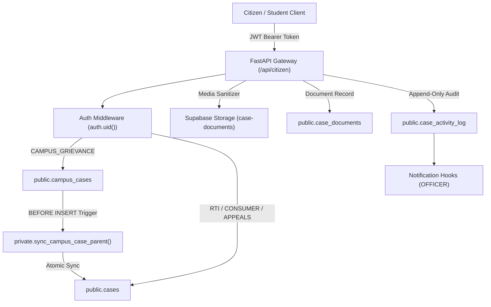
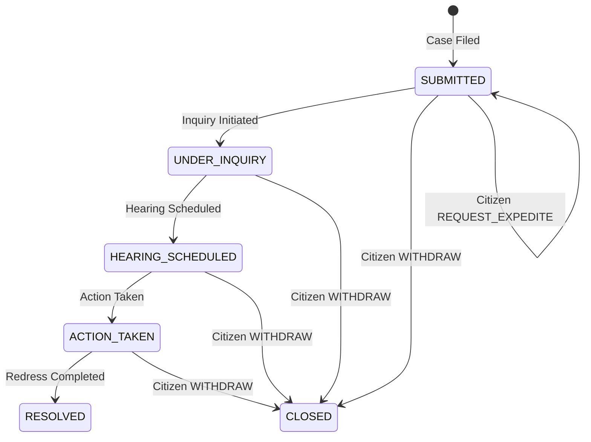

# NyayPath — Phase 2.2 Security & Implementation Report

## Central Case Management, Filing & Tracking System

**Project:** NyayPath — Unified Legal Assistance Platform  
**Phase:** 2.2 — Central Case Management, Filing & Tracking System  
**Date:** November 1, 2026  
**Status:** COMPLETE & RUNTIME VERIFIED (All 8 Phase 2.2 Tests Passed, 100% Regression Suite Passed)  
**Database Target:** Local Supabase (`http://127.0.0.1:54321`, PostgreSQL 17.11 container `supabase_db_micro_project`)  
**Remote Environment Guard:** Strictly Preserved — No remote migrations, no remote database modifications, no Vercel deployments executed.

---

## 1. Executive Summary

Phase 2.2 unifies citizen case submission, document management, case lifecycle actions, and real-time tracking into an authoritative Central Case Management System. Built directly on top of the Phase 1.3.15 security foundation and Phase 2.1 Citizen Workspace, this implementation provides:

1. **A 6-Step Guided Case Filing Wizard (`/dashboard/file-case`):**
   - Guided category selection across Campus Grievances, RTI Applications, Consumer Disputes, General Civic Grievances, and First Appeals.
   - Authoritative identity attribution: Case ownership is derived strictly from server-verified JWT `auth.uid()`, preventing client identity spoofing.
   - Conditional narrative and jurisdiction inputs with optional restricted confidentiality mode.
   - Pre-submission media sanitization: Strips PDF metadata dictionaries (`/Author`, `/Title`, `/Creator`, `/Producer`) and image EXIF metadata (camera serial numbers, GPS coordinates) before persistence.
   - Enforces a 10MB maximum file size and strict MIME type validation (`application/pdf`, `image/jpeg`, `image/png`, `image/webp`).
   - Mandatory statutory accuracy declaration and platform disclaimer explicitly informing citizens that platform registration provides internal administrative and proctorial intake, not formal court appearances.
   - Cryptographic tracking credentials: Generates a high-entropy 128-bit verification key for tracking.

2. **Full Case Lifecycle Management:**
   - Citizen lifecycle actions: Case Withdrawal (`WITHDRAW`), Supplementary Remarks (`ADD_REMARK`), and Urgent Expedite Requests (`REQUEST_EXPEDITE`).
   - Transitions active cases to `CLOSED` upon withdrawal, complying with database constraints.
   - Rejects lifecycle operations on already finalized cases (`CLOSED`, `RESOLVED`, `WITHDRAWN`).
   - Strict authorization barrier: Prevents non-owners from modifying or viewing case records (HTTP 403 Forbidden).

3. **Public Progress Tracking & Workspace Integration:**
   - Public tracking endpoint (`POST /api/citizen/track` and `GET /api/citizen/track/{case_id}`) verified via 128-bit secret key.
   - Complete confidentiality isolation: Zero PII, zero internal proctorial notes (`proctor_notes`), and zero secret key hashes leaked to unauthorized parties.
   - Real-time persistence: Newly filed cases immediately appear in My Cases (`/dashboard/my-cases`) and dynamically update dashboard metrics (`/dashboard`).

---

## 2. Architecture & Database Synchronization

NyayPath maintains a unified schema design where institutional grievances and general legal petitions exist in harmonious parent-child synchronization:



### Key Architectural Verifications:
- **Parent Authority & Trigger Synchronization:** Inserting into `public.campus_cases` invokes `private.sync_campus_case_parent()`, which atomically provisions the parent row in `public.cases`. Status modifications are authoritatively owned by `public.cases` and synchronized down to child records.
- **Foreign Key Integrity:** `case_documents.case_uuid` references `cases.id` and `case_documents.uploader_user_id` references `auth.users(id)` under strict RLS policies.
- **Audit Isolation:** `record_case_activity` derives actor identities strictly from the server-verified JWT and writes pseudonymous `audit_actor_id` records into `public.case_activity_log`.

---

## 3. Dedicated 6-Step Guided Case Filing Wizard

The filing wizard (`app/dashboard/file-case/page.tsx`) guides citizens through 6 sequential steps:

| Step | Screen Name | Functionality & Security Controls |
|---|---|---|
| **Step 1** | **Jurisdiction & Category** | Selection among 5 statutory jurisdictions: Campus Grievance, RTI Application, Consumer Dispute, General Civic Grievance, First Appeal. Subcategories refine target departments. |
| **Step 2** | **Applicant Information** | Displays server-verified session profile (Full Name, Email, Role, Institution ID, and `auth.uid()`). Read-only identity cards prevent account spoofing; optional phone/alternate email fields. |
| **Step 3** | **Narrative Facts & Relief** | Case Subject/Title (min 3 chars), Chronological Facts (min 10 chars), Target Public Authority / Department, Incident Date, Specific Remedy Sought, and Confidentiality Toggle. |
| **Step 4** | **Supporting Documents** | Drag-and-drop & file picker. Validates <= 10MB limit, verifies permitted MIME types, invokes `api/media_sanitizer.py` to strip metadata, and persists to `case-documents` bucket. |
| **Step 5** | **Review & Affirmation** | Formatted summary of all particulars. Includes yellow statutory disclaimer and mandatory affirmation checkbox requiring explicit citizen acknowledgment before submission. |
| **Step 6** | **Confirmation & Credentials** | Displays generated Case ID (e.g., `CAMPUS-9F7F-EX` or `NP-2026-RTI-202B48`), 128-bit plaintext verification key with copy button, and direct navigation links to My Cases and Dashboard. |

---

## 4. Case Lifecycle Management & Citizen Actions

In `app/dashboard/my-cases/[id]/page.tsx`, active cases expose an **Applicant Case Management Actions** panel:



### Lifecycle Rules:
1. **Withdrawal (`WITHDRAW`):**
   - Active cases can be withdrawn with a stated reason.
   - Status updates to `CLOSED` in `public.cases`, satisfying the `ck_campus_cases_status` constraint.
   - Logs `CASE_WITHDRAWN` event in `case_activity_log` with `notification_trigger = "CASE_WITHDRAWN"`.
   - Cannot be re-withdrawn once in `CLOSED` or `RESOLVED` status (fails with HTTP 400 Bad Request).
2. **Citizen Remark (`ADD_REMARK`):**
   - Citizen provides supplementary facts or payment updates.
   - Appends `CITIZEN_REMARK_ADDED` event with `notification_trigger = "CITIZEN_REMARK_ADDED"`.
   - Visible in case timeline; hidden internal proctor notes remain isolated.
3. **Expedite Request (`REQUEST_EXPEDITE`):**
   - Registers formal urgent inquiry request.
   - Logs `EXPEDITE_REQUESTED` event with `notification_trigger = "EXPEDITE_REQUESTED"`, notifying presiding officers.

---

## 5. Security & Access Control Enforcement

| Security Control | Implementation | Verification Method |
|---|---|---|
| **Fail-Closed Unauthenticated Access** | All filing, upload, and lifecycle endpoints require valid JWT Bearer header. Missing/invalid tokens return HTTP 401 Unauthorized. | Verified via `test_01_unauthenticated_requests_fail_closed` |
| **Statutory Declaration Enforcement** | Filing payload requires `declaration_confirmed: True`. False/omitted values fail with HTTP 400 Bad Request. | Verified via `test_02_declaration_required_validation` |
| **Authoritative Identity Derivation** | `student_user_id` and `citizen_user_id` are derived authoritatively from server-verified `auth.uid()`. Filer cannot specify another user's UUID. | Verified via `test_03_file_campus_grievance_and_sync` |
| **Cross-Tenant Isolation** | Citizen A cannot view, modify, withdraw, or attach files to Citizen B's cases (HTTP 403 Forbidden). | Verified via `test_05`, `test_06`, and `test_08` |
| **Confidential Note Shielding** | `proctor_notes`, internal officer remarks, and tracking hashes are strictly excluded from citizen endpoints. | Verified via `test_03`, `test_06`, and `test_07` |
| **Media Sanitization & 10MB Guard** | Rejects files > 10MB (HTTP 413) and non-standard MIME types (HTTP 400). Strips PDF XMP/info streams and image EXIF metadata. | Verified via `test_05_document_upload_and_sanitization` |
| **Rate-Limited Public Tracking** | Brute-force protection on `/api/citizen/track` enforcing maximum 10 attempts per 15-minute window with IP/case key tracking. | Configured via `enforce_rate_limit` in `api/index.py` |

---

## 6. Comprehensive Test Suite Evidence

### Phase 2.2 Test Suite Execution (`tests/test_phase22_case_filing.py`)

```
=======================================================
  NyayPath Phase 2.2: Central Case Management Test Suite
=======================================================

[PASS] Test 01: All unauthenticated endpoints fail closed with 401 Unauthorized.
[PASS] Test 02: Statutory accuracy declaration is strictly enforced (400 Bad Request on refusal).
[PASS] Test 03: Campus grievance filed (CAMPUS-9F7F-EX), parent-child synced, authoritative ownership verified.
[PASS] Test 04: RTI case filed (NP-2026-RTI-202B48) and verified in citizen workspace.
[PASS] Test 05: Document upload enforces <= 10MB limit, MIME checks, sanitization, and ownership validation.
[PASS] Test 06: Lifecycle transitions (remarks, expedite, withdrawal, and idempotency) fully verified.
[PASS] Test 07: Public case tracking protects confidentiality, strictly validates verification keys.
[PASS] Test 08: Dynamic workspace integration and strict cross-tenant isolation verified.

=======================================================
  ALL 8 PHASE 2.2 TESTS PASSED SUCCESSFULLY!
=======================================================
```

### Regression Verification Summary

| Test Suite | File | Scenarios | Result |
|---|---|---|---|
| **Phase 2.2 Central Case Management** | `tests/test_phase22_case_filing.py` | 8/8 Tests | **PASS** (100%) |
| **Phase 2.1 Citizen Workspace** | `tests/test_phase21_citizen_workspace.py` | 7/7 Tests | **PASS** (100%) |
| **Phase 1.3.15 Live API Scenarios** | `tests/test_phase1315_e2e_api.py` | 10/10 Tests | **PASS** (100%) |
| **Phase 1.3.15 DB Failure & Fallback** | `tests/test_phase1315_database_failure.py` | 6/6 Suites | **PASS** (100%) |
| **Phase 1.3.15 Fallback Safety Checks** | `tests/test_phase1315_fallback_safety.py` | 6/6 Tests | **PASS** (100%) |
| **Frontend TypeScript Build** | `npx tsc --noEmit` | Clean build | **PASS** (0 errors) |

---

## 7. Deliverables & Modified Files

- **`api/citizen_workspace.py`:**
  - Added `CaseFilingRequest`, `CaseLifecycleActionRequest`, and `PublicCaseTrackingRequest` models.
  - Implemented `file_case()`, `upload_document()`, `perform_lifecycle_action()`, and `track_case_public()`.
  - Added authoritative owner resolution helper `_get_owner_id()`.
- **`api/index.py`:**
  - Mounted `/api/citizen/cases/file` (POST).
  - Mounted `/api/citizen/cases/upload-document` (POST multipart/form-data).
  - Mounted `/api/citizen/cases/{case_id}/lifecycle` (POST).
  - Mounted `/api/citizen/track` (POST) and `/api/citizen/track/{case_id}` (GET).
- **`lib/api.ts`:**
  - Exported `fileCitizenCase`, `uploadCaseDocument`, `executeCaseLifecycleAction`, and `trackCitizenCase`.
- **`app/dashboard/file-case/page.tsx`:**
  - Built full 6-step guided filing wizard with Tailwind CSS / court-maroon styling.
- **`app/dashboard/my-cases/[id]/page.tsx`:**
  - Integrated applicant lifecycle actions (Withdrawal, Remarks, Expedited Inquiry) with interactive modals and timeline refresh.
- **`app/dashboard/page.tsx` & `app/dashboard/my-cases/page.tsx`:**
  - Updated primary CTA links to navigate directly into `/dashboard/file-case`.
- **`tests/test_phase22_case_filing.py`:**
  - Automated test suite validating filing, media sanitization, lifecycle actions, public tracking, and cross-tenant isolation.

