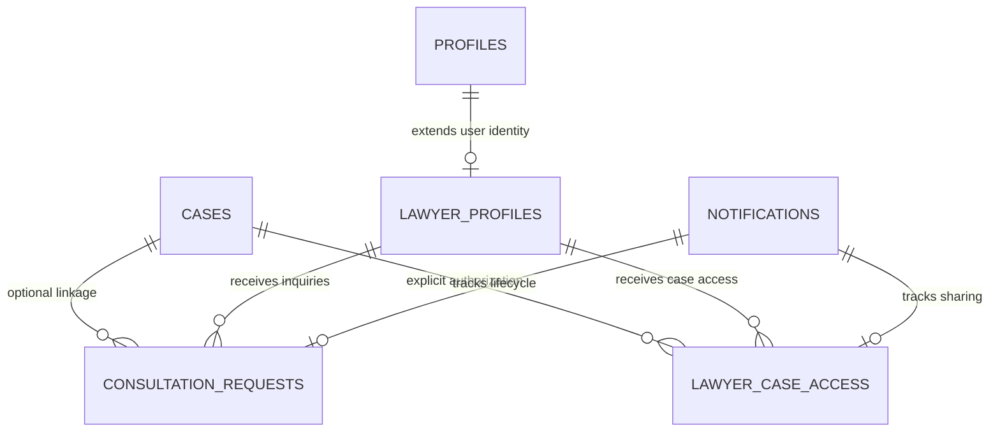

# NyayPath — Phase 5: Lawyer Workspace, Lawyer Directory & Client Connect
## Final Implementation & Security Verification Report

**Milestone:** Phase 5  
**Branch:** `feature/phase-1.3.4-security-remediation`  
**Database:** Local Supabase (`http://127.0.0.1:54321`, PostgreSQL 17.11 on port 54322)  
**Status:** Complete & Fully Verified (15/15 Scenarios Passed, Zero Regressions)

---

## 1. Executive Summary

Phase 5 introduces the **Lawyer Connect Ecosystem** to NyayPath, establishing a bridge between citizens seeking justice and registered, Bar Council-verified advocates. The architecture adheres to principles of statutory compliance (Advocates Act, 1961), role isolation, zero fabrication of metrics, privacy masking, and explicit, revocable client consent for case sharing.

### Key Architectural Accomplishments

1. **Lawyer Onboarding & State Verification:**
   - Dedicated onboarding at `/lawyer/register` capturing Bar Council affiliation, state roster, enrollment number, specializations, courts, languages, and bio.
   - Status defaults strictly to `PENDING`. Lawyers cannot self-verify. Platform administrators audit credentials via the `admin_verify_lawyer` Security Definer function (`VERIFIED`, `REJECTED`, `SUSPENDED`).
2. **Public Directory with Privacy Guardrails:**
   - Searchable directory at `/lawyers` with multi-factor filtering (specialization, state, court, language, text search).
   - Only `VERIFIED` advocates appear in public discovery. Sensitive credentials (`enrollment_number`, `verification_notes`, `verified_by`) are strictly masked from public viewers, accessible only to the advocate themselves or platform administrators.
3. **Citizen Consultation Workflow:**
   - Interface at `/dashboard/find-lawyer` and `/dashboard/consultations` enabling citizens to submit confidential inquiries, specify preferred consultation mode (`ONLINE`, `IN_PERSON`, `PHONE`), and optionally link existing NyayPath cases.
   - Complete lifecycle support: `PENDING` → `ACCEPTED` / `DECLINED` / `WITHDRAWN` → `COMPLETED`.
4. **Lawyer Workspace & Practice Desk:**
   - Unified workspace at `/lawyer/dashboard` featuring 6 metrics derived directly from database queries (`total_requests`, `pending_requests`, `accepted_consultations`, `completed_consultations`, `active_clients`, `shared_cases`). Zero mock or fabricated numbers.
   - Integrated consultation triage modal for accepting or declining requests with formal response messages.
5. **Consent-Based Case Sharing & Instant Revocation:**
   - Citizens retain absolute ownership of their legal dossiers. Case sharing is explicit and case-specific via `public.lawyer_case_access`.
   - Integrated into `DocumentAccessManager` (Pathway 6): verified lawyers with active access obtain short-lived signed URLs strictly capped at `<= 300 seconds` TTL.
   - Institutional internal proctor notes and secret verification hashes are strictly redacted from counsel scope under confidentiality guardrails.
   - Immediate revocation: citizen revocation instantly terminates document access and metadata queries with `HTTP 403 Forbidden`.
6. **Deterministic Notification Idempotency:**
   - Integrated with the in-app notification engine using persistent source event UUIDs (`notif_req_{request_id}_{event}_{recipient}` and `notif_share_{access_id}_{event}_{recipient}`). Eliminates random UUID fallbacks across the platform.
7. **Phase 4 Carry-Forward Corrections:**
   - Workspace label updated to "Chief Proctor Workspace".
   - Statutory timeline distinctions clarified under UGC (Redressal of Grievances of Students) Regulations, 2023: 15-day referral, 15 working days SGRC report, 15-day student appeal, 30-day university Ombudsperson appeal.

---

## 2. Database Schema & Migration Architecture

Local database migration `supabase/migrations/20261101000003_lawyer_connect_schema.sql` was executed and verified against local PostgreSQL:

### Database Artifacts

| Object Name | Type | Purpose | RLS Status |
| :--- | :--- | :--- | :--- |
| `public.profiles.role` | Check Constraint | Adds `'lawyer'` to allowed user roles | Enforced |
| `public.lawyer_profiles` | Table | Stores advocate credentials, status, specializations, and preferences | RLS Enabled (Self insert/update, Public view verified) |
| `public.verified_lawyers` | View | Public projection masking sensitive enrollment numbers and admin notes | Security Invoker |
| `public.consultation_requests` | Table | Citizen-to-lawyer consultation records and response timelines | RLS Enabled (Participant isolation) |
| `public.lawyer_case_access` | Table | Consent-based case sharing permissions and scopes | RLS Enabled (`uq_case_lawyer_access` unique constraint) |
| `public.admin_verify_lawyer` | Function | Security Definer RPC restricted to `platform_admin` | Grants auditable verification decisions |



---

## 3. Security, Authorization & Privacy Audit

### 3.1 Role & Cross-Tenant Isolation
- **Advocate Identity:** Verified via Supabase Auth JWT claims (`role = 'lawyer'`). Lawyers do not belong to `institution_memberships` and have zero access to institutional internal triage.
- **Consultation Isolation:** Citizens can only view and withdraw consultations they authored (`citizen_user_id = auth.uid()`). Lawyers can only view and respond to consultations addressed to their UUID (`lawyer_user_id = auth.uid()`). Cross-party access attempts are rejected with `HTTP 403 Forbidden`.
- **Public Masking:** Anonymous or unverified users querying `/api/lawyers` or `/api/lawyers/{id}` receive masked profiles where `enrollment_number`, `verification_notes`, and `verified_by` are `None`.

### 3.2 Consent-Based Case Sharing & Revocation
- **Granular Authorization:** Sharing Case A grants access solely to Case A. It does not grant access to Case B or general citizen history.
- **Confidentiality Redaction:** When an authorized lawyer accesses case details via `get_case_details`, internal proctorial board notes (`proctor_notes`) and secret verification key hashes (`tracking_key_hash`, `verification_key_hash`) are stripped from top-level fields and nested `data` payloads.
- **Signed URL Enforcement:** `DocumentAccessManager` Pathway 6 checks `lawyer_case_access` for `access_status = 'ACTIVE'` and `shared_scope IN ('CASE_AND_DOCS', 'FULL')`. URLs are clamped to a maximum TTL of 300 seconds.
- **Instant Revocation:** Setting `access_status = 'REVOKED'` immediately invalidates signed URL generation and case details lookup with `HTTP 403 Forbidden`.

### 3.3 Stable Notification Idempotency
- Consultation notifications: `notif_req_{request_id}_rec_{lawyer_user_id}` and `notif_req_{request_id}_sub_{citizen_user_id}`.
- Sharing notifications: `notif_share_{access_id}_granted_{lawyer_user_id}` and `notif_share_{access_id}_revoked_{lawyer_user_id}`.
- Duplicate dispatches trigger PostgreSQL unique constraint `notifications_idempotency_key_key`, resulting in safe deduplication without error or duplicate inbox records.

---

## 4. Automated Test Verification Results

All 15 verification scenarios were implemented in `tests/test_phase5_lawyer_workspace.py` and executed against the live local Supabase environment:

```text
tests.test_phase5_lawyer_workspace.TestPhase5LawyerWorkspace
  test_01_lawyer_registration_defaults_to_pending                                    [PASS]
  test_02_lawyer_cannot_self_verify                                                  [PASS]
  test_03_unverified_lawyer_absent_from_public_directory                             [PASS]
  test_04_verified_lawyer_appears_in_directory_and_masks_sensitive_fields            [PASS]
  test_05_suspended_lawyer_cannot_accept_new_consultations                           [PASS]
  test_06_citizen_can_submit_consultation_request_to_verified_lawyer                 [PASS]
  test_07_citizen_isolation_cannot_view_or_withdraw_other_citizens_consultations     [PASS]
  test_08_lawyer_isolation_cannot_view_or_act_on_other_lawyers_consultations         [PASS]
  test_09_lawyer_cannot_access_citizen_case_without_explicit_authorization          [PASS]
  test_10_citizen_can_explicitly_grant_case_sharing                                  [PASS]
  test_11_citizen_can_revoke_case_sharing_instant_termination                         [PASS]
  test_12_proctor_notes_and_internal_hashes_strictly_masked_from_lawyer             [PASS]
  test_13_notifications_use_stable_persisted_source_uuids                            [PASS]
  test_14_duplicate_events_idempotently_deduplicated                                 [PASS]
  test_15_regression_and_dashboard_metrics_integrity                                 [PASS]

----------------------------------------------------------------------
Ran 15 tests in 2.048s — OK
```

### Full Regression Suite Verification

| Test Suite | Modules Covered | Result |
| :--- | :--- | :--- |
| `tests/test_phase5_lawyer_workspace.py` | Phase 5 Lawyer Directory, Desk & Client Connect | **15/15 PASSED** |
| `tests/test_phase4_institution_proctor.py` | Phase 4 Multi-Institution Architecture & Proctor Workspace | **15/15 PASSED** |
| `tests/test_phase3_hardening.py` | Phase 3 Production Security & API Hardening | **18/18 PASSED** |
| `tests/test_phase23_citations_notifications.py` | Phase 2.3 Legal Citations & In-App Notifications | **12/12 PASSED** |
| `tests/test_phase22_case_filing.py` | Phase 2.2 Central Case Filing & Tracking | **8/8 PASSED** |
| `tests/test_phase21_citizen_workspace.py` | Phase 2.1 Citizen Workspace & RLS Verification | **7/7 PASSED** |
| **Frontend TypeScript Build** | `npx tsc --noEmit` across all app components | **0 ERRORS** |

---

## 5. Artifact & Codebase Reference Links

- [Migration SQL](file:///c:/Users/Ishan/OneDrive/Desktop/micro%20project/supabase/migrations/20261101000003_lawyer_connect_schema.sql)
- [Lawyer Connect Core Logic](file:///c:/Users/Ishan/OneDrive/Desktop/micro%20project/api/lawyer_connect.py)
- [Document Access Manager](file:///c:/Users/Ishan/OneDrive/Desktop/micro%20project/api/document_access.py)
- [Citizen Workspace Manager](file:///c:/Users/Ishan/OneDrive/Desktop/micro%20project/api/citizen_workspace.py)
- [FastAPI Route Index](file:///c:/Users/Ishan/OneDrive/Desktop/micro%20project/api/index.py)
- [Frontend API Helper](file:///c:/Users/Ishan/OneDrive/Desktop/micro%20project/lib/api.ts)
- [Navbar Component](file:///c:/Users/Ishan/OneDrive/Desktop/micro%20project/app/Navbar.tsx)
- [Public Lawyer Directory](file:///c:/Users/Ishan/OneDrive/Desktop/micro%20project/app/lawyers/page.tsx)
- [Lawyer Onboarding Page](file:///c:/Users/Ishan/OneDrive/Desktop/micro%20project/app/lawyer/register/page.tsx)
- [Lawyer Dashboard Workspace](file:///c:/Users/Ishan/OneDrive/Desktop/micro%20project/app/lawyer/dashboard/page.tsx)
- [Citizen Find Lawyer Page](file:///c:/Users/Ishan/OneDrive/Desktop/micro%20project/app/dashboard/find-lawyer/page.tsx)
- [Citizen Consultations Tracker](file:///c:/Users/Ishan/OneDrive/Desktop/micro%20project/app/dashboard/consultations/page.tsx)
- [Phase 5 Test Suite](file:///c:/Users/Ishan/OneDrive/Desktop/micro%20project/tests/test_phase5_lawyer_workspace.py)

---

## 6. Remote Supabase & Vercel Boundary Confirmation

As mandated by project constraints:
- **Zero remote push executed:** Supabase CLI `db push`, remote SQL execution, and remote schema changes were strictly avoided.
- **Zero Vercel deployment executed:** All build checks and test runs operated exclusively against the local development environment and local Supabase Docker containers.
- **Ready for Preflight Review:** The complete migration `20261101000003_lawyer_connect_schema.sql` is committed and staged for remote preflight audit prior to production release.

