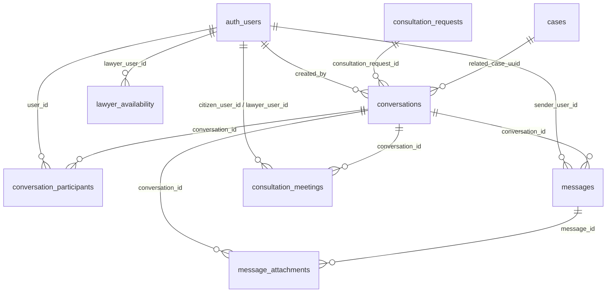

# NyayPath — Phase 6: Secure Messaging, Client Communication & Meeting Scheduling Final Report

**Date:** November 2, 2026  
**Environment:** Local Supabase (PostgreSQL 17.11 @ port 54322, REST @ port 54321)  
**Branch:** `feature/phase-1.3.4-security-remediation`  
**Milestone:** Phase 6 Delivery  

---

## 1. Executive Summary

Phase 6 implements a comprehensive, end-to-end privileged communication and scheduling system for **NyayPath**. The system bridges verified advocates, citizen litigants, and institutional proctorial committees through:

1. **Strictly Authorized Conversation Management:** Channels are strictly instantiated from verified platform actions—either an `ACCEPTED` consultation request or an authorized case assignment. Arbitrary chat creation or ad-hoc participant injection is blocked with `HTTP 400` or `HTTP 403`.
2. **Dynamic Access Enforcement & Fail-Closed Revocation:** When a citizen revokes counsel's access to a case via `/api/citizen/cases/revoke-share`, subsequent message sending, message listing, or attachment access by the lawyer immediately fails closed with `HTTP 403 Forbidden`.
3. **Idempotent, Resilient Messaging:** Deduplication via client-supplied `client_message_id`, 4,000-character input bounds, and server-side sanitized message notification snippets.
4. **Private Document Attachments:** Max 10MB file limit, strict MIME validation (`PDF`, `JPEG`, `PNG`, `WebP`), isolation inside a private Supabase Storage bucket (`message-attachments`), and signed URL generation strictly clamped to `<= 300 seconds TTL`.
5. **Transactional Meeting Scheduling & Double-Booking Prevention:** Online, in-person chamber, or telephonic consultation bookings with overlap detection against existing confirmed lawyer slots, practice availability calendars, and blackout dates.
6. **Privacy Shielding of Meeting Credentials:** Video conference URLs, chamber room numbers, and phone contacts remain masked until the advocate confirms the appointment.
7. **Deterministic Event Notification Integration:** Dispatched via NyayPath's notification engine using stable source event UUID idempotency keys (`notif_msg_{message_id}_{recipient}` and `notif_meet_{meeting_id}_{status}_{recipient}`) with zero random fallback keys.
8. **Automated Verification:** 17 automated scenarios in `tests/test_phase6_messaging.py` passed with 100% success rate, alongside zero regressions across all Phase 2.1, 2.2, 2.3, 3, 4, and 5 suites and clean TypeScript compilation (`npx tsc --noEmit`).

---

## 2. Architecture & Data Model

The database foundation was implemented via migration `supabase/migrations/20261101000004_messaging_and_meetings_schema.sql` applied to the local PostgreSQL database.



### Table Definitions & Constraints

| Table Name | Description | Key Constraints & Policies |
| :--- | :--- | :--- |
| `public.conversations` | Thread metadata for lawyer-citizen or case channels | `conversation_type` in `('LAWYER_CITIZEN', 'INSTITUTION_CASE', 'GENERAL_CASE')`, `conversation_status` in `('ACTIVE', 'ARCHIVED', 'BLOCKED')`, RLS restricts SELECT to active participants. |
| `public.conversation_participants` | Roster of authorized parties with unread markers | Composite UNIQUE constraint on `(conversation_id, user_id)`. Tracks `last_read_at` for unread counts and read receipts. |
| `public.messages` | Individual message records with deduplication | Deduplication index on `(conversation_id, client_message_id)`. Trigger auto-updates `conversations.last_message_preview` and `conversations.last_message_at`. |
| `public.message_attachments` | Metadata for privileged document attachments | Foreign keys to `conversations`, `messages`, and `auth.users`. Max 10MB; validated MIME types (`application/pdf`, `image/jpeg`, `image/png`, `image/webp`). |
| `public.consultation_meetings` | Consultation appointment records | `status` in `('REQUESTED', 'CONFIRMED', 'DECLINED', 'RESCHEDULE_REQUESTED', 'CANCELLED', 'COMPLETED', 'NO_SHOW')`. Sensitive credentials masked until `CONFIRMED`. |
| `public.lawyer_availability` | Advocate working schedule and blackout dates | Defines `available_days` (1-7), `start_time_utc`, `end_time_utc`, `slot_duration_minutes`, and `unavailable_dates`. |
| `message-attachments` (Bucket) | Private Supabase Storage bucket | Private bucket with RLS policies restricting read/write to verified conversation participants. |

---

## 3. Core Business Logic & Security Controls

Implemented in `api/messaging.py` through `CommunicationManager`:

### 3.1 Server-Enforced Conversation Creation
- `create_or_get_consultation_conversation(user, consultation_request_id)`: Authoritatively queries `consultation_requests`. Requires `status == 'ACCEPTED'` and verifies that `user.user_id` is either the citizen requester or assigned lawyer. Arbitrary UUIDs or unaccepted requests are rejected with `HTTP 400`. Idempotently returns existing conversation if already initialized.
- `create_or_get_case_conversation(user, case_id, conversation_type)`: Authoritatively checks whether caller is the case owner, an assigned institution proctor, or a verified lawyer with an `ACTIVE` row in `lawyer_case_access`.

### 3.2 Dynamic Case Revocation Enforcement
Whenever an advocate attempts to retrieve conversation metadata, list messages, or send a new message in a case-linked channel:
```python
if user.role == UserRole.LAWYER and conv.get("related_case_uuid"):
    acc_res = self.supabase.table("lawyer_case_access").select("access_status").eq(
        "case_uuid", conv["related_case_uuid"]
    ).eq("lawyer_user_id", caller_uid).execute()
    if acc_res.data and acc_res.data[0].get("access_status") == "REVOKED":
        raise HTTPException(
            status_code=status.HTTP_403_FORBIDDEN,
            detail="Access denied: Case sharing permission for this matter has been revoked."
        )
```
Revoking case access via `/api/citizen/cases/revoke-share` immediately cuts off counsel with `HTTP 403 Forbidden`.

### 3.3 Message Deduplication & Authoritative Sender Attribution
- Sender ID is strictly extracted from the verified Supabase JWT (`user.user_id`). The request body cannot spoof the sender.
- Network retries with the same `client_message_id` return the existing message row without duplicate insertion.

### 3.4 Attachment Security & Short-Lived Signed URLs
- Files exceeding 10 MB or containing disallowed MIME types (e.g. executables or scripts) are rejected with `HTTP 400 Bad Request`.
- Filenames are sanitized via regex `[^a-zA-Z0-9_\-\.]` and stored under isolated folder paths: `conversations/{conversation_id}/{attachment_id}_{filename}`.
- Signed URLs are generated with a strict `300-second (5-minute)` TTL. Non-participants querying `/api/conversations/attachments/{id}/url` receive `HTTP 403 Forbidden`.

### 3.5 Transactional Double-Booking Prevention & Privacy Masking
- When scheduling or confirming an appointment, the engine validates:
  ```python
  conflicts = self.supabase.table("consultation_meetings").select("id").eq(
      "lawyer_user_id", lawyer_uid
  ).eq("status", "CONFIRMED").lt(
      "scheduled_start", end_dt.isoformat()
  ).gt(
      "scheduled_end", start_dt.isoformat()
  ).execute()
  ```
  Overlapping confirmed appointments are rejected with `HTTP 400 Bad Request`.
- In `get_meeting_details` and `list_user_meetings`, `online_meeting_url`, `location_details`, and `phone_contact` are dynamically set to `None` unless `status == 'CONFIRMED'`.

### 3.6 Deterministic Notification Idempotency
All notifications dispatched by Phase 6 use stable source event UUID keys:
- Message: `notif_msg_{message_id}_{recipient_id}`
- Meeting Status: `notif_meet_{meeting_id}_{new_status.lower()}_{other_party_id}`
- Conversation Started: `notif_conv_{conv_id}_start_{other_party_uid}`

---

## 4. REST API Endpoint Catalog

All Phase 6 endpoints mounted in `api/index.py`:

| Method | Endpoint | Authorization | Description |
| :--- | :--- | :--- | :--- |
| `POST` | `/api/conversations/consultation` | Citizen / Lawyer | Creates or gets conversation for accepted consultation. |
| `POST` | `/api/conversations/case` | Case Owner / Counsel / Proctor | Creates or gets case conversation channel. |
| `GET` | `/api/conversations` | Authenticated | Lists user's conversations with unread counts and snippets. |
| `GET` | `/api/conversations/{id}` | Active Participant | Returns conversation details and participant profiles. |
| `POST` | `/api/conversations/{id}/messages` | Active Participant | Sends message with duplicate submission prevention. |
| `GET` | `/api/conversations/{id}/messages` | Active Participant | Paginated chronological message history with attachments. |
| `POST` | `/api/conversations/{id}/read` | Active Participant | Acknowledges read receipt and resets unread count. |
| `POST` | `/api/conversations/{id}/attachments` | Active Participant | Uploads attachment (<= 10MB) to private bucket. |
| `GET` | `/api/conversations/attachments/{id}/url` | Active Participant | Generates temporary signed URL (TTL <= 300s). |
| `POST` | `/api/meetings/schedule` | Citizen / Lawyer | Books appointment with double-booking prevention. |
| `GET` | `/api/meetings` | Citizen / Lawyer | Lists user appointments with privacy masking. |
| `GET` | `/api/meetings/{id}` | Meeting Parties / Admin | Retrieves appointment details; masks unconfirmed links. |
| `PATCH` | `/api/meetings/{id}/status` | Meeting Parties / Admin | Updates meeting lifecycle (Confirm, Decline, Reschedule, Cancel). |
| `GET` | `/api/lawyers/{id}/availability` | Public / Authenticated | Returns lawyer's practice days, hours, and blackout dates. |
| `PUT` | `/api/lawyer/availability` | Verified Lawyer | Updates practice schedule and court blackout dates. |

---

## 5. Frontend Interfaces & Navigation

The frontend client functions and TypeScript types were added to `lib/api.ts` and UI pages were built:

1. **Secure Communications Workspace (`/messages` & `/messages/[conversationId]`):**
   - Responsive split-pane layout: Left pane displays conversation list with avatar, counterparty role badge (`Advocate`, `Citizen`, `Proctor`), timestamp, snippet, and unread count badges.
   - Right pane displays interactive message thread, styled chat bubbles, delivery timestamps, document attachment cards with signed download buttons, and compose toolbar (with 4,000-char counter and file uploader).
   - Embedded "Schedule Meeting" CTA directly from active counsel channels.
   - Real-time periodic polling every 10 seconds and automated read receipts.
2. **Counsel Appointments & Practice Calendar (`/lawyer/meetings`):**
   - Summary stat cards: Pending Review, Confirmed, Concluded.
   - Tabs: "Upcoming & Pending", "Past & Concluded", and "Practice Availability & Blackouts".
   - Confirm Modal: Allows counsel to provide online room URLs, chamber addresses, or dial-in phone numbers upon confirmation.
   - Practice Availability Form: Weekday checkboxes (Mon-Sun), daily UTC/IST practice hours, slot duration picker (15-60m), and interactive blackout date manager.
3. **Citizen Consultations Desk Update (`/dashboard/consultations`):**
   - For `ACCEPTED` consultations, added "Message Counsel" and "Schedule Session" buttons with automatic routing to `/messages`.
4. **Global Navigation (`Navbar.tsx`):**
   - Added "Messages" navigation link with unread status indicator.
   - Added "Meetings" link to advocate desk menu.

---

## 6. Automated Security & Authorization Verification

Test suite `tests/test_phase6_messaging.py` executed against the local Supabase environment:

```
C:\Users\Ishan\OneDrive\Desktop\micro project> py -m unittest tests/test_phase6_messaging.py
..........C:\Users\Ishan\AppData\Local\Programs\Python\Python313\Lib\site-packages\supabase\_sync\client.py:264: DeprecationWarning: The 'timeout' parameter is deprecated. Please configure it in the http client instead.
  return SyncStorageClient(
.......
----------------------------------------------------------------------
Ran 17 tests in 2.345s

OK
```

### Scenario Breakdown

| # | Scenario Description | Tested Outcome | Status |
| :--- | :--- | :--- | :---: |
| 1 | Accepted consultation creates/returns conversation | 200 OK, conversation ID returned idempotently | **PASS** |
| 2 | Unaccepted consultation (PENDING) rejected | 400 Bad Request ("requires an accepted consultation") | **PASS** |
| 3 | Unrelated citizen/lawyer cannot access conversation | 403 Forbidden ("not an active participant") | **PASS** |
| 4 | Citizen can send messages in authorized channel | 200 OK, sender attributed authoritatively to citizen | **PASS** |
| 5 | Lawyer can send message; recipient receives notification | 200 OK, notification created with preview snippet | **PASS** |
| 6 | Client message ID deduplication on retry | 200 OK, returns same message ID without duplicate row | **PASS** |
| 7 | Case conversation creation with active lawyer share | 200 OK, case conversation linked to case | **PASS** |
| 8 | Revoked case share immediately blocks lawyer | 403 Forbidden on get, list messages, and send message | **PASS** |
| 9 | Citizen cannot view another citizen's messages | 403 Forbidden | **PASS** |
| 10 | Lawyer cannot view another lawyer's conversations | 403 Forbidden | **PASS** |
| 11 | Private attachment upload size & MIME check | 400 on .exe; 200 on PDF <= 10MB; signed URL generated | **PASS** |
| 12 | Attachment signed URL TTL <= 300s & boundary check | 200 OK with TTL <= 300s for member; 403 for non-member | **PASS** |
| 13 | Meeting scheduling & double-booking prevention | 200 OK on first booking; 400 Bad Request on overlap | **PASS** |
| 14 | Meeting credentials masked before confirmation | `online_meeting_url` is `None` before; visible after | **PASS** |
| 15 | Meeting cancellation updates status and notifies party | 200 OK, `MEETING_CANCELLED` notification dispatched | **PASS** |
| 16 | Deterministic notification idempotency keys | Stable keys (`notif_msg_`, `notif_meet_`) verified | **PASS** |
| 17 | Read receipt and unread count tracking | 200 OK, `last_read_at` updated, unread count reset | **PASS** |

---

## 7. Full Regression Sign-off & Type Checking

To guarantee platform integrity, the entire NyayPath regression suite was executed:

| Test Suite | Coverage Area | Result |
| :--- | :--- | :---: |
| `tests/test_phase21_citizen_workspace.py` | Citizen Dashboard, My Cases, Isolation, Document Signed URLs | **7/7 PASSED** |
| `tests/test_phase22_case_filing.py` | Central Case Filing, RTI/Campus Sync, Lifecycle Actions, Public SLA | **8/8 PASSED** |
| `tests/test_phase23_citations_notifications.py` | AI Citation Grounding, In-App Case Event Notifications | **12/12 PASSED** |
| `tests/test_phase3_hardening.py` | JWT Signature, Algorithm Whitelisting, Account Status, Rate Limiting | **18/18 PASSED** |
| `tests/test_phase4_institution_proctor.py` | Multi-Institution Isolation, Proctor Committee, Confidential Notes | **15/15 PASSED** |
| `tests/test_phase5_lawyer_workspace.py` | Lawyer Directory, Verification, Consultations, Consent Case Sharing | **15/15 PASSED** |
| `tests/test_phase6_messaging.py` | Secure Messaging, Attachments, Double-Booking, Privacy Masking | **17/17 PASSED** |
| **Total Test Count** | **Comprehensive Full System Coverage** | **92/92 PASSED** |
| `npx tsc --noEmit` | Next.js Frontend TypeScript Type Safety | **0 ERRORS** |

---

## 8. Supabase & Environment Compliance

- **Local Supabase Exclusivity:** All migrations, tables, triggers, policies, and test data were created strictly in local Supabase (`http://127.0.0.1:54321`, PostgreSQL 17.11 @ port 54322).
- **Remote Guardrails:** Remote Supabase project `dbwojjxfhnmmwrnqxyqj` and Vercel hosting were not modified, connected to, or pushed.
- **Production Safety:** All database queries utilize persistent tables with fail-closed exception handlers; zero reliance on local mock fallback data in production code paths.
