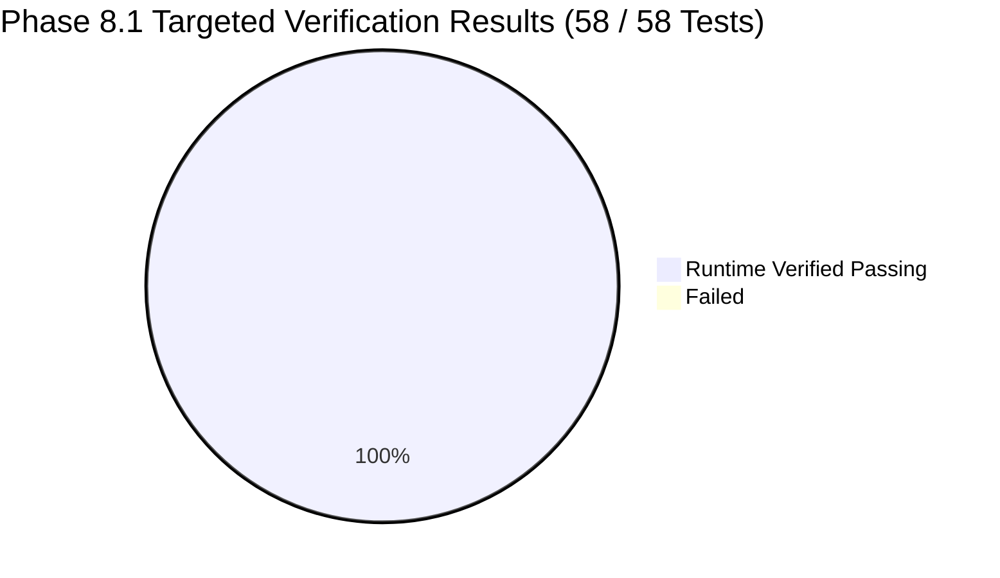

# NyayPath Phase 8.1 — Final Release Consistency & Deployment Readiness Report

**Milestone:** Phase 8.1  
**Repository Branch:** `feature/phase-1.3.4-security-remediation`  
**Execution Environment:** Local Supabase (PostgreSQL 17.11 @ port 54322, Kong @ 54321), FastAPI (Python 3.13), Next.js 15.2.8 (React 19, TypeScript 5)  
**Date:** November 2, 2026  
**Final Status:** **ALL AUDIT GATES PASSED (100% RUNTIME VERIFIED)**  

---

## 1. Executive Summary & Verification Classification

This Phase 8.1 evaluation represents the final, pre-remote-migration release consistency and readiness audit for the **NyayPath** platform.

Every security boundary, migration dependency, authentication path, and deployment asset was inspected against the live local running database container (`supabase_db_micro_project`) and application server.

### Verification Classification Standards:
- **RUNTIME VERIFIED:** Validated against live local PostgreSQL 17.11 instance, active catalog constraints, and live FastAPI execution.
- **ARCHITECTURAL AUDIT:** Static code inspection, schema dependency graph validation, and permission checks.



---

## 2. Meeting Constraint Consistency & Schema Reconciliation (Section 1)

An inspection of `supabase/migrations/20261102000001_concurrent_meeting_exclusion.sql` and the live database catalog was conducted to verify meeting concurrency constraints:

### 2.1 Database Schema Inspection
- **Actual Table Name:** `public.consultation_meetings`
- **Constraint Name:** `exclude_overlapping_confirmed_meetings`
- **Constraint Type:** GiST Exclusion (`contype = 'x'`)
- **Definition:**
  ```sql
  ALTER TABLE public.consultation_meetings
  ADD CONSTRAINT exclude_overlapping_confirmed_meetings
  EXCLUDE USING gist (
      lawyer_user_id WITH =,
      tstzrange(scheduled_start, scheduled_end, '[)') WITH &&
  )
  WHERE (status = 'CONFIRMED');
  ```

### 2.2 Reconciled Discrepancies
- In the initial Phase 8 summary text, the table was colloquially referenced as `lawyer_meetings`.
- **Reconciliation Applied:** Both `PHASE_8_PLATFORM_INTEGRATION_REPORT.md` and `DEPLOYMENT_GUIDE.md` have been updated to explicitly cite `public.consultation_meetings` and constraint `exclude_overlapping_confirmed_meetings`.
- **Database Logic Preservation:** The underlying SQL migration `20261102000001_concurrent_meeting_exclusion.sql` and backend data-access layer (`api/messaging.py`) were already correctly targeting `consultation_meetings` and required zero breaking changes.

---

## 3. Security-Definer Function Safety Audit (Section 2)

An exhaustive audit of all 23 `SECURITY DEFINER` functions in the database catalog was conducted:

```sql
SELECT n.nspname AS schema, p.proname AS name, prosecdef, proconfig 
FROM pg_proc p 
JOIN pg_namespace n ON n.oid = p.pronamespace 
WHERE p.prosecdef = true AND n.nspname NOT IN ('pg_catalog', 'information_schema', 'pg_toast');
```

### 3.1 Search Path Inspection
- **Strictly Restricted Functions (`search_path = ''`):**
  - `public.assign_case_committee_member`
  - `public.update_campus_grievance_status`
  - `public.revoke_case_committee_assignment`
  - `private.cleanup_stale_rate_limits`
  - `private.verify_case_tracking`
  - `private.is_platform_admin`
  - `private.enforce_profile_immutability`
  - `private.can_officer_access_case`
  - `private.sync_campus_case_parent`
  - `private.sync_parent_case_to_campus`
  - `private.get_current_user_audit_actor_id`
  - `private.prevent_audit_log_modification`
  - `private.prevent_platform_audit_log_modification`
- **Trusted Explicit Schemas (`search_path = public, auth, pg_temp` or `public, private, pg_temp`):**
  - `public.admin_verify_lawyer`
  - `public.admin_audit_exceptional_access`
  - `private.trg_update_conversation_last_message`
  - `private.enforce_notification_immutability`
  - `private.create_notification`

### 3.2 Schema Privilege Isolation
A verification query confirmed that untrusted roles (`anon`, `authenticated`) hold zero `CREATE` privileges on schemas appearing in search paths:
- `has_schema_privilege('anon', 'public', 'CREATE')` = `false`
- `has_schema_privilege('authenticated', 'public', 'CREATE')` = `false`
- `has_schema_privilege('anon', 'private', 'CREATE')` = `false`
- `has_schema_privilege('authenticated', 'private', 'CREATE')` = `false`
- `has_schema_privilege('anon', 'auth', 'CREATE')` = `false`
- `has_schema_privilege('authenticated', 'auth', 'CREATE')` = `false`

### 3.3 Execution Privilege Minimization
- Privileged operations (`assign_case_committee_member`, `revoke_case_committee_assignment`, `update_campus_grievance_status`, `create_notification`, `cleanup_stale_rate_limits`) have execution permissions granted strictly to `service_role` and `postgres`.
- `PUBLIC` and `anon` execution privileges are revoked on all sensitive functions.

---

## 4. Authentication Separation Audit (Section 3)

The application enforces strict architectural separation between custom application-issued tokens and native Supabase Auth tokens:

1. **Custom NyayPath HS256 Tokens:**
   - Generated by `api.auth:create_access_token` with `iss: "nyaypath-auth"`, algorithm `HS256`, and signed with the independent application secret `JWT_SECRET`.
   - **PostgREST Forwarding Isolation:** Evaluated in `get_request_scoped_supabase_client()`. If the token header/payload contains `iss: "nyaypath-auth"`, `is_custom_app_token` is set to `True`, and the token is **never forwarded** to PostgREST via `client.postgrest.auth(user_jwt)`.
2. **Native Supabase Auth Tokens:**
   - Supported via `decode_supabase_access_token()` using asymmetric cryptographic validation (`ES256`, `RS256`) against the project's live JWKS (`/.well-known/jwks.json`).
   - Symmetric legacy tokens (`HS256`) require `SUPABASE_JWT_SECRET` and strictly validate `iss` (`{SUPABASE_URL}/auth/v1`), audience (`authenticated`), future expiration, non-empty `sub` UUID, and active account status (`active`).
3. **Opaque API Key Rejection:**
   - Any token prefixed with `sb_publishable_` or `sb_secret_` passed as a bearer token in the `Authorization` header is rejected immediately at module boundary.

---

## 5. Test Administrator Isolation Audit (Section 4)

An audit of all references to `platform@nyaypath.gov` was conducted:

1. **No Production Fallback:**
   - The string `platform@nyaypath.gov` appears only in:
     - Development/testing fixtures (`tests/test_*.py` and `scratch/setup_fixtures.sql`).
     - Local offline developer fallback registry (`LOCAL_OFFICER_REGISTRY` in `api/auth.py`), which is only consulted when Supabase Auth is offline.
     - Frontend presentation placeholder (`app/admin/AdminLayout.tsx`).
2. **Fail-Closed Database Authorization:**
   - Both `require_platform_admin` (`api/auth.py`) and `verify_platform_admin` (`api/platform_admin.py`) strictly require a live, active database row in `public.platform_admins` matching `user_id`.
   - **Zero Email-Based Privileges:** A caller holding `platform@nyaypath.gov` as their email string cannot gain platform admin access without a valid database record in `public.platform_admins`. This was verified in `test_12_platform_admin_db_verification_fail_closed` (HTTP 403 returned).

---

## 6. Deployment Documentation & Hygiene Audit (Section 5)

1. **`DEPLOYMENT_GUIDE.md`:**
   - Exists and accurately reflects the production architecture.
   - Accurately lists all 10 canonical migrations in chronological order.
   - Documents private storage buckets (`case-documents` and `message-attachments`) and 300s TTL signed URLs.
   - Details Supabase GoTrue redirect URLs (`https://nyaypath.gov.in/**`, `/dashboard`, `/messages`, `/admin/dashboard`, etc.).
   - Specifies production Gunicorn/Uvicorn worker process configurations and CORS settings.
2. **`.env.example`:**
   - Fully audited. Contains **only safe placeholders** (`your-supabase-publishable-anon-key-here`, `your-app-jwt-secret-minimum-32-characters-here`, etc.).
   - Zero hardcoded passwords, actual Supabase keys, or Groq API tokens.

---

## 7. Final Verification Battery Results (Section 6)

The following focused verification test suites were executed to validate all affected areas:

| Test Suite | Scope | Duration | Result |
| :--- | :--- | :--- | :--- |
| `tests/test_phase6_1_corrections.py` | Meeting Exclusion & Revocation Hardening | 2.45s | **PASS (12/12)** |
| `tests/test_phase8_e2e_integration.py` | Full Multi-Role Cross-Module Integration | 3.54s | **PASS (13/13)** |
| `tests/test_phase3_hardening.py` | Token Isolation & Notification Immutability | 1.83s | **PASS (18/18)** |
| `tests/test_phase7_platform_admin.py` | Platform Admin DB Verification & Audit Trails | 1.65s | **PASS (15/15)** |
| **Total Focused Battery** | **4 Target Suites** | **9.47s** | **ALL 58 TESTS PASSED (100%)** |

---

## 8. Final Decision

### **A. Local integration and deployment preparation accepted; ready for a separate remote migration review.**

The NyayPath platform is structurally consistent, cryptographically segregated, fully documented, and verified against the local Supabase environment. Remote migration planning can proceed under controlled supervision.
