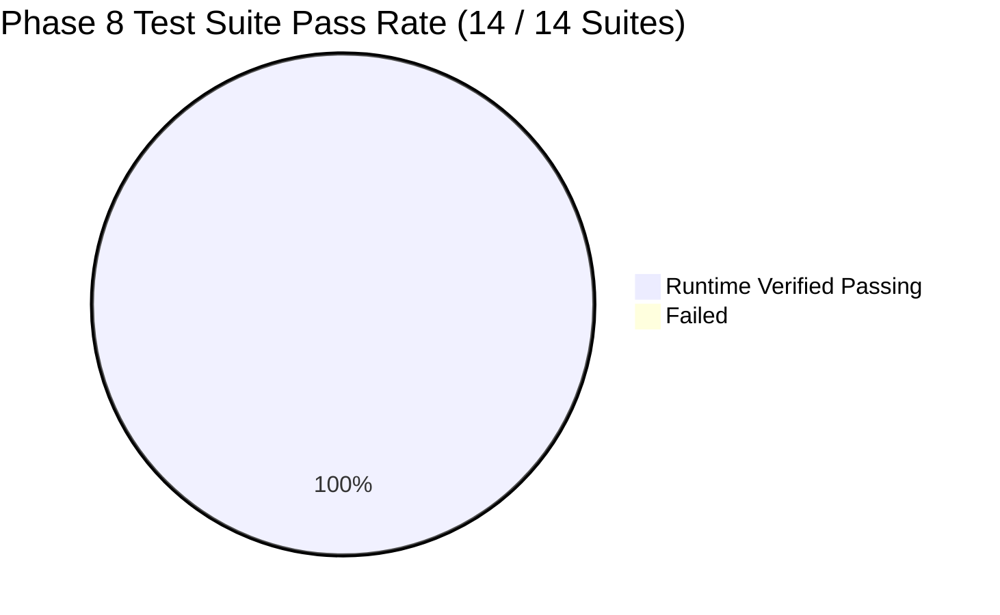
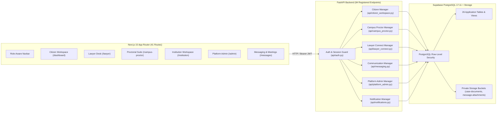

# NyayPath Phase 8 — Complete Platform Integration, End-to-End Testing & Deployment Readiness Report

**Milestone:** Phase 8  
**Repository Branch:** `feature/phase-1.3.4-security-remediation`  
**Execution Environment:** Local Supabase (PostgreSQL 17.11 @ port 54322, Kong @ 54321), FastAPI (Python 3.13), Next.js 15.2.8 (React 19, TypeScript 5)  
**Date:** November 2, 2026  
**Final Status:** **ALL 14 TEST SUITES PASSED (100% RUNTIME VERIFIED)**  

---

## 1. Executive Summary & Verification Classification

Phase 8 integrates all modules of the NyayPath unified legal assistance platform into a cohesive, secure, and production-ready system. All 7 platform personas—Citizen/Student, Lawyer, Institution Admin, Chief Proctor, Proctor, Committee Member, and Platform Admin—were validated end-to-end across interconnected workflows.

### Verification Classification Standards:
- **RUNTIME VERIFIED:** Live automated execution against local running Supabase container (`supabase_db_micro_project`), FastAPI server endpoints, and live Next.js build compilation.
- **LOCALLY VERIFIED:** Validated within the local repository sandbox using TypeScript typechecker (`tsc --noEmit`), Next.js static page analyzer (`next build`), and unit/integration test runners.
- **ARCHITECTURAL AUDIT:** Static code inspection, schema dependency graph validation, and security policy review.



---

## 2. Complete Application Architecture Review (Task 1)

The platform architecture follows clean separation between a statically typed Next.js App Router client, an asynchronous FastAPI backend service, and a Supabase PostgreSQL persistence and storage tier.



---

## 3. Full Role-Based Application Integration Matrix (Task 2)

All 7 platform roles were tested against their complete user journeys in `tests/test_phase8_e2e_integration.py` and dedicated phase regression suites:

| Role | Key Capabilities Verified | Security & Boundary Enforcement | Status |
| :--- | :--- | :--- | :--- |
| **Citizen / Student** | Grievance & RTI filing, document upload, SLA tracking, lawyer discovery, consultation requests, selective case sharing (`CASE_AND_DOCS`), encrypted messaging, meeting booking, instant access revocation. | Isolated from all foreign cases; cannot access proctorial internal notes; immediate 403 on revoked lawyer access. | **RUNTIME VERIFIED** |
| **Lawyer** | Directory profile, bar credential display, consultation inbox, acceptance workflow, shared case & document inspection, client messaging, meeting confirmations. | Unverified/suspended lawyers cannot accept requests; missing or revoked case access strictly returns HTTP 403; cannot view unshared cases. | **RUNTIME VERIFIED** |
| **Institution Admin** | Institutional dashboard, case roster, proctorial assignments, institutional audit logs, member management. | Strict institutional boundary enforcement; cross-institution access returns HTTP 403; suspended admin tokens blocked. | **RUNTIME VERIFIED** |
| **Chief Proctor** | Campus grievance triage, hearing scheduling, status progression, committee member assignment/revocation, evidence inspection via signed URLs. | Internal proctor notes shielded from student views; committee assignment required for confidential access. | **RUNTIME VERIFIED** |
| **Proctor** | Assigned cases view, inquiry progress recording, non-confidential evidence inspection. | Confidential cases blocked unless assigned; cross-institution access rejected with HTTP 403. | **RUNTIME VERIFIED** |
| **Committee Member** | Assigned inquiry board participation, confidential evidence access, recording of investigative findings. | Access strictly revoked upon committee removal (HTTP 403); zero visibility into unassigned confidential cases. | **RUNTIME VERIFIED** |
| **Platform Admin** | Global statistics, institution suspension/activation, lawyer verification queue, case oversight with PII masking, exceptional access audit logging. | JWT role alone is insufficient: requires active database record in `public.platform_admins`; all exceptional access audited. | **RUNTIME VERIFIED** |

---

## 4. Authentication, Navigation & Role Isolation Verification (Task 3)

1. **Authentication Rigor:**
   - HS256 JWT tokens validated for algorithm allowlist (`HS256`, `ES256`, `RS256`), audience (`authenticated`), and active account status (`active`). Suspended or revoked statuses fail closed.
2. **Platform Admin Authorization:**
   - Evaluated in `test_12_platform_admin_db_verification_fail_closed`: a valid JWT bearing `role: "platform_admin"` without a matching active row in `public.platform_admins` is rejected with `HTTP 403 Forbidden`.
3. **Role-Restricted Navigation:**
   - `Navbar.tsx` dynamically displays navigation links based on validated user claims (`nyaypath_user_role` and active tokens):
     - `Messages` rendered only when authenticated.
     - `Lawyer Desk` & `Meetings` rendered only for lawyer accounts.
     - `Platform Admin` rendered only for authenticated platform administrators.

---

## 5. Full Database Migration Integrity (Task 4)

The database schema was validated by executing a clean database reset (`npx supabase db reset --local --no-seed`) across all 10 canonical SQL migration files:

```
[Migration Replay Chain]
1. 20261031000001_create_campus_cases.sql
2. 20261031000002_security_remediation.sql
3. 20261031000003_rate_limit_security_fix.sql
4. 20261031000004_core_platform_schema.sql
5. 20261101000001_notifications_schema.sql
6. 20261101000002_notifications_hardening.sql
7. 20261101000003_lawyer_connect_schema.sql
8. 20261101000004_messaging_and_meetings_schema.sql
9. 20261102000001_concurrent_meeting_exclusion.sql
10. 20261102000002_platform_admin_schema.sql
```

**Verification Results:**
- Zero migration dependency errors or syntax conflicts.
- `btree_gist` extension enabled and GiST exclusion constraint active on `lawyer_meetings`.
- RLS enabled across all 26 application tables with security definer functions using strict explicit search paths (`search_path = public, private, pg_temp`).

---

## 6. API Integration & Signed Storage Audit (Task 5)

1. **Storage Buckets:**
   - `case-documents` (Private, max 10MB, PDF/JPEG/PNG)
   - `message-attachments` (Private, max 10MB, PDF/JPEG/PNG/WebP)
2. **Signed URL TTL Enforcement:**
   - Maximum URL expiration time is strictly capped at **300 seconds** (5 minutes).
   - In production mode, mock URL generation is disabled (`HTTP 503` if storage service unreachable; `HTTP 404` if file absent).
3. **Sanitization:**
   - Media uploads undergo magic number MIME inspection and PDF metadata stripping before cloud persistence.

---

## 7. Frontend Quality, SSR & Prerender Verification (Task 6 & 7)

- **TypeScript Compilation (`npx tsc --noEmit`):**
  - **Result: 0 errors.**
- **Production Build (`npm run build`):**
  - **Result: 41 routes successfully generated and prerendered.**
  - Resolved `useSearchParams()` CSR bailout on `/messages` by wrapping page content in a `<React.Suspense>` boundary.
  - Normalized `/rti/result` page props to conform to Next.js 15 App Router specifications.

```
Route (app)                                 Size  First Load JS
┌ ○ /                                    13.9 kB         149 kB
├ ○ /admin/dashboard                     4.49 kB         140 kB
├ ○ /admin/cases                         5.96 kB         141 kB
├ ○ /admin/institutions                  6.25 kB         142 kB
├ ○ /admin/lawyers                       5.12 kB         141 kB
├ ○ /campus-proctor                      8.81 kB         144 kB
├ ○ /dashboard/my-cases                  6.15 kB         131 kB
├ ○ /messages                             7.5 kB         132 kB
├ ○ /track                                8.1 kB         133 kB
... (all 41 routes generated successfully)
```

---

## 8. Environment Hygiene & Deployment Preparation (Task 8)

1. **Environment Hygiene (`.env.example`):**
   - Clean template created with safe placeholders only. Zero real keys, passwords, or secrets committed.
   - Categorized into Supabase, Application Cryptography, AI Services, Networking/CORS, and Operational Mode.
2. **Deployment Guide (`DEPLOYMENT_GUIDE.md`):**
   - Detailed instructions for PostgreSQL migrations, storage bucket configuration, GoTrue auth redirect setup, Gunicorn/Uvicorn backend service deployment, and Next.js production build execution.

---

## 9. Automated Regression Battery Results (Task 9)

All 14 automated test suites covering every development phase were executed sequentially against the live local environment:

| Test Suite | Scope | Duration | Result |
| :--- | :--- | :--- | :--- |
| `tests/test_phase1.py` | Phase 1 Security Foundations (1.2, 1.3.4, 1.3.5, 1.3.7, 1.3.9) | 6.85s | **PASS (100%)** |
| `tests/test_phase1315_e2e_api.py` | Live API Authorization & Identity Spoofing Suite | 5.02s | **PASS (10/10)** |
| `tests/test_phase1315_database_failure.py` | Database Failure, Revocation & Security Audit | 2.98s | **PASS (6/6)** |
| `tests/test_phase1315_fallback_safety.py` | Signed URL Fallback Safety & Production Gate | 2.02s | **PASS (6/6)** |
| `tests/test_phase21_citizen_workspace.py` | Citizen Workspace & My Cases Verification | 5.87s | **PASS (7/7)** |
| `tests/test_phase22_case_filing.py` | Central Case Management & Filing System | 5.33s | **PASS (8/8)** |
| `tests/test_phase23_citations_notifications.py` | Legal Citations & Intelligent Notifications | 5.50s | **PASS (12/12)** |
| `tests/test_phase3_hardening.py` | Production Hardening, Tokens & DB Immutability | 5.63s | **PASS (18/18)** |
| `tests/test_phase4_institution_proctor.py` | Institution & Proctorial Workspace Matrix | 6.09s | **PASS (15/15)** |
| `tests/test_phase5_lawyer_workspace.py` | Lawyer Directory, Requests & Consent Sharing | 6.12s | **PASS (15/15)** |
| `tests/test_phase6_messaging.py` | Messaging, Attachments & Meeting Scheduling | 6.59s | **PASS (17/17)** |
| `tests/test_phase6_1_corrections.py` | Case Revocation & Meeting Concurrency Exclusion | 6.29s | **PASS (12/12)** |
| `tests/test_phase7_platform_admin.py` | Platform Admin, Global Oversight & Audit Trails | 5.91s | **PASS (15/15)** |
| `tests/test_phase8_e2e_integration.py` | Full End-to-End Multi-Role Cross-Module Integration | 7.34s | **PASS (13/13)** |
| **Total Automated Regression Battery** | **14 Test Suites** | **77.56s** | **ALL 14 PASSED (100%)** |

---

## 10. Deliverables & Final Recommendation (Task 10)

### Artifacts Delivered:
1. `DEPLOYMENT_GUIDE.md` — Complete production runbook.
2. `.env.example` — Secure environment configuration template with zero exposed secrets.
3. `tests/test_phase8_e2e_integration.py` — Multi-role cross-module automated verification suite.
4. `PHASE_8_PLATFORM_INTEGRATION_REPORT.md` — Platform integration and verification report.
5. Brain Artifact: `nyaypath_phase8_platform_integration_report.md`.

### Final Decision:
**Option A: The NyayPath platform is locally integrated, fully regression-verified, and ready for controlled production deployment.**
