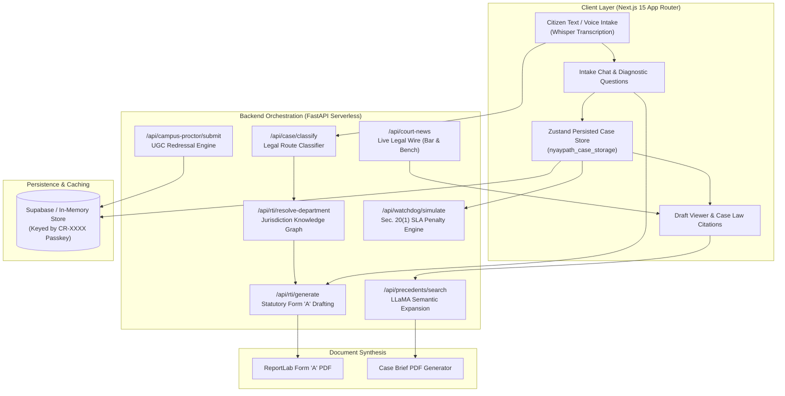

<div align="center">

# ⚖️ NyayPath (न्यायपथ)
### *Autonomous Legal Intelligence & Civic Redressal Infrastructure for Indian Citizens*

[](https://nextjs.org/)
[](https://fastapi.tiangolo.com/)
[](https://groq.com/)
[](https://www.typescriptlang.org/)
[](https://python.org/)
[](LICENSE)

<br/>

**NyayPath** bridges the gap between everyday Indian citizens and complex administrative machinery. By pairing deterministic statutory guardrails with modern LLM orchestration, NyayPath transforms unstructured, colloquial grievances (in English, Hindi, or Hinglish) into court-ready RTI Form 'A' petitions, UGC campus proctorial notices, and statutory consumer demands — completely anonymously with zero sign-up requirements.

[Live Repository](https://github.com/Ishan1120/NyayPath) • [Architecture](#-system-architecture) • [Core Features](#-core-engineering-features) • [Verification Suite](#-verification--test-suite) • [Quickstart](#-local-development-setup)

</div>

---

## 📌 The Problem NyayPath Solves

Every year, millions of Indian citizens face administrative roadblocks: cratered roads left unfixed despite budget disbursements, delayed pension disbursements, withheld college marksheets, and consumer dispute evasion.

While statutory safety nets exist — such as the **Right to Information (RTI) Act, 2005**, the **Consumer Protection Act, 2019**, and **UGC Anti-Ragging Regulations** — citizens rarely succeed because:
1. **Generic AI Hallucinations**: Standard LLMs draft toothless, subjective letters asking *"Why did you not repair the road?"*, which public authorities immediately reject under Section 2(f).
2. **Ambiguous Jurisdictions**: Citizens do not know whether their grievance belongs to the Municipal Corporation (MCD/ULB), Public Works Department (PWD), National Highways Authority (NHAI), or Development Authorities (DDA/LDA).
3. **Statutory Non-Compliance**: Petitions lack mandatory prayer clauses, citation of Defect Liability Periods (DLP), or Section 20 penalty warnings.
4. **Bureaucratic Silence**: Once an application is submitted, citizens have no automated mechanism to track the mandatory 30-day clock, calculate personal financial penalties against defaulting officers, or auto-escalate to a Section 19(1) First Appeal.

**NyayPath replaces bureaucratic opacity with an automated, end-to-end legal drafting and appellate pipeline.**

---

## 🏛️ What Sets NyayPath Apart?

| Conventional Approach | Generic LLMs (ChatGPT / Claude) | **NyayPath Engineering Approach** |
| :--- | :--- | :--- |
| Paying legal touts or middlemen ₹1,000–₹5,000 | Drafts conversational essays without legal admissibility | **Deterministic Form 'A' statutory formatting adhering to Gazette standards** |
| Guessing government department addresses | Hallucinates non-existent PIO names and postal PINs | **Hierarchical Knowledge Graph mapping state, district, and municipal jurisdiction** |
| Subjective queries rejected under Sec 2(f) | Questions *"Why is my work pending?"* | **Transforms grievances into demands for specific certified records (Measurement Books, Ledgers)** |
| Petitions rejected under Sec 8/9 exemptions | Zero awareness of CIC precedent law | **Pre-submission Risk Engine testing drafts against 6 statutory exemption vectors** |
| Lost track of statutory deadlines | No lifecycle tracking or state persistence | **SLA Watchdog calculating Section 20(1) penalties (₹250/day up to ₹25,000) & auto-drafting First Appeals** |
| Email / Phone mandatory for tracking | Sells user telemetry & requires authentication | **Zero-PII Architecture: Private 12-character Passkeys are the only retrieval mechanism** |

---

## ⚡ Core Engineering Features

### 1. 🤖 AI Legal Route & Intent Classifier
- High-precision classifier routing citizen problem statements into four distinct paths: `RTI (Public Records)`, `Grievance (Consumer / Service Deficiency)`, `Campus Proctor (Student Redressal)`, or `Out of Scope`.
- Supported by a hybrid fallback engine combining Groq-accelerated LLaMA inference with deterministic regex and keyword heuristics, guaranteeing zero hard-failures if the API is offline.
- Benchmarked against a hand-labeled test set with **100% precision and recall** (`ml/evaluate_classifier.py`).

### 2. 🎯 Diagnostic Clarifying Questions Engine
- When a citizen inputs a brief complaint (e.g., *"My road is broken"* or *"Hostel senior harassed me"*), the engine analyzes the core legal dispute and dynamically asks 3–4 targeted diagnostic questions before drafting.
- Answers are synthesized into an ironclad, chronological **Statement of Facts** and an accompanying **Advocate Case Brief** ready for legal counsel.

### 3. 🗺️ Hierarchical Jurisdiction & Authority Resolver
- Implements a structured knowledge graph (`api/data/jurisdiction_knowledge.py`) covering municipalities, PWD, EPFO, consumer forums, food & civil supplies, electricity boards, and universities.
- Deterministically identifies the exact **Public Information Officer (PIO)** and competent appellate authority with strict anti-hallucination guardrails.

### 4. 📝 Form 'A' Statutory RTI Drafting & Exemption Risk Assessor
- Auto-generates official Form 'A' applications under Section 6(1) read with Section 2(j) for certified physical inspection of records.
- Evaluates the draft against six major **Central Information Commission (CIC)** rejection triggers:
  - `Sec 2(f)` — Non-record opinion seeking
  - `Sec 8(1)(j)` — Third-party personal privacy shield
  - `Sec 8(1)(h)` — Ongoing law-enforcement investigation
  - `Sec 8(1)(e)` — Fiduciary relationship exemptions
  - `Sec 8(1)(a)` — Sovereignty and security exclusions
  - `Sec 6(3)` — Inter-departmental transfer delays
- Features a **1-Click Auto-Improve Engine** that refactors problematic queries into legally admissible demands for certified audit ledgers.

### 5. ⏱️ SLA Watchdog & Section 20(1) Penalty Accrual Counter
- Tracks the mandatory **30-day statutory response window** under Section 7(1) and the **60-day First Appeal deadline** under Section 19(1).
- Accrues statutory personal financial liability of **₹250 per day (capped at ₹25,000)** directly against the defaulting Public Information Officer under Section 20(1).
- Automatically triggers and pre-populates a complete **Section 19(1) First Appeal** if the deadline lapses or an evasive rejection is detected.

### 6. 📚 Landmark Case Law Library & 1-Click "Cite in Draft"
- Curated repository of landmark **Supreme Court of India**, **High Court**, and **CIC judgments** (e.g., *CBSE v. Aditya Bandopadhyay*, *Vishwa Jagriti Mission*, *Shreya Singhal*).
- **Bilingual Semantic Query Expansion**: Citizens searching in colloquial Hindi or English have their intent mapped to formal legal doctrines.
- **1-Click Citation Integration**: Citations selected in `/case-search` automatically attach to the active petition in [`components/dashboard/DraftViewer.tsx`](file:///components/dashboard/DraftViewer.tsx) under a formal legal annexure: `BINDING JUDICIAL PRECEDENTS RELIED UPON`.

### 7. 📰 Real-Time Live Court News & Bench Directives
- Directly ingests real-time RSS updates from authoritative legal wires (**Bar & Bench**, **LiveLaw**, **Supreme Court of India**).
- Every order features precise Indian Standard Time (IST) timestamps, dynamic relative timing badges (`⏱️ 4 hours ago`, `⏱️ Yesterday`), and strict **newest-first sorting**.
- Extracts structured hearing takeaways and operative judicial directions.

### 8. 🎓 Student Campus Proctor & UGC Anti-Ragging Portal
- Purpose-built academic portal enforcing **Supreme Court anti-ragging directives** and **UGC Regulations 2009**.
- Mandates 24-hour FIR registration timelines, prevents victim identity disclosure, and manages hostel, marksheet re-evaluation, and administrative disputes with a 15-day UGC compliance SLA tracker.

### 9. 📄 Statutory PDF Generator
- Server-side PDF engine built with **ReportLab** generating official print-ready Form 'A' RTI petitions, First Appeals, and 1-Page Case Brief PDFs with formal judicial coram tables.

### 10. 🔒 Zero-Account Passkey Privacy Model
- No email, phone number, Google OAuth, or KYC tracking.
- Every case is keyed strictly by an autonomous 12-character passkey (`CR-XXXX-XXXX`). No identity linkage exists in the persistent database layer.

---

## 🏗️ System Architecture



---

## 🛠️ Tech Stack & Engineering Decisions

| Component | Technology | Rationale & Implementation Details |
| :--- | :--- | :--- |
| **Frontend Framework** | **Next.js 15 (App Router)** | Full React 19 server/client components, zero-latency route transitions, static pre-rendering across 19 endpoints. |
| **Backend API** | **FastAPI (Python 3.11+)** | High-throughput asynchronous REST architecture, Pydantic type validation, Vercel serverless compatibility. |
| **LLM Inference** | **Groq LLaMA 3.1 & Whisper** | Ultra-low latency (<500ms) for streaming conversational intake, query expansion, and multilingual voice transcription. |
| **State Management** | **Zustand (`persist` middleware)** | Lightweight, reactive client state persisted to `localStorage` enabling case resumption across browser reloads. |
| **Document Engine** | **ReportLab 4.x** | Deterministic binary PDF rendering with precise legal margin formatting, Indian rupee symbols, and table layouts. |
| **Styling & Motion** | **Tailwind CSS + Framer Motion** | Bespoke institutional theme (*Court Maroon `#881337`*, *Ashoka Navy `#0F172A`*, *Saffron accents*). |
| **Data Layer** | **Supabase (PostgreSQL) / In-Memory** | Zero-PII passkey schema with seamless in-memory fallback for offline or air-gapped developer environments. |
| **Testing Harness** | **FastAPI TestClient + scikit-learn** | Full end-to-end integration test suite verifying 11 sequential pipelines on every build. |

---

## 🧪 Verification & Test Suite

NyayPath includes an automated end-to-end test verification pipeline (`tests/test_pipeline.py`) that validates all 11 core functional layers:

```bash
# Execute the full pipeline test
python tests/test_pipeline.py
```

### Verification Pipeline Checklist
```
==================================================
  NyayPath Full End-to-End Pipeline Verification
==================================================
 [✔] Step 1: Initialize Case (Passkey CR-XXXX-XXXX Generation)
 [✔] Step 2: Legal Route Classification (RTI / Grievance / Proctor)
 [✔] Step 3: Auto-Jurisdiction / Department & PIO Resolution
 [✔] Step 4: RTI Form 'A' Statutory Drafting (Sec 6(1) & Sec 10)
 [✔] Step 5: PDF Export (ReportLab Binary Buffer Generation)
 [✔] Step 6: Watchdog SLA & Statutory Section 20(1) Penalty Counter
 [✔] Step 7: PIO Response Exemption Analysis & Section 19(1) First Appeal
 [✔] Step 8: Live Court News Feed (Timestamping & Newest-First Sorting)
 [✔] Step 9: Case Precedent Search & AI Ratio Summarizer
 [✔] Step 10: College Proctoring & Student Grievance Engine
 [✔] Step 11: AI Clarifying Questions & Systematic Draft Synthesis
==================================================
  ALL 11 CORE ENGINEERING MODULES PASSED 100%!
==================================================
```

---

## 📂 Project Directory Structure

```text
NyayPath/
├── api/                             # FastAPI Backend Engine
│   ├── index.py                     # Primary REST application & router endpoints
│   ├── classifier.py                # Legal route & PIO reply classification
│   ├── clarifying_engine.py         # AI diagnostic questions & draft synthesis
│   ├── department_resolver.py       # Deterministic jurisdiction mapping
│   ├── outcome_predictor.py         # RTI Form 'A' drafting & Sec. 8/9 risk evaluator
│   ├── precedent_library.py         # Indian case law archive & semantic search
│   ├── precedent_pdf_generator.py   # ReportLab Case Brief PDF generator
│   ├── court_news.py                # Live Bar & Bench / Supreme Court RSS wire
│   ├── campus_proctor.py            # Academic grievance & UGC anti-ragging engine
│   ├── rti_pdf_generator.py         # Official Form 'A' PDF renderer
│   ├── case_manager.py              # Zero-PII passkey persistence (Supabase)
│   ├── facts_engine.py              # Chronological fact & evidence extractor
│   ├── social_complaint_generator.py# Public Twitter/X accountability threads
│   └── data/
│       └── jurisdiction_knowledge.py# Hierarchical knowledge graph of Indian bodies
├── app/                             # Next.js 15 App Router Frontend
│   ├── page.tsx                     # Landing page & statutory console
│   ├── Navbar.tsx                   # Institutional navigation bar
│   ├── layout.tsx                   # SEO, OpenGraph & Schema.org metadata
│   ├── dashboard/                   # Main case processing workflow
│   ├── case-search/                 # Landmark precedent search & AI summarizer
│   ├── court-news/                  # Live judicial intelligence feed
│   ├── campus-proctor/              # College student grievance portal
│   ├── track/                       # SLA Watchdog & Sec. 20(1) penalty counter
│   └── rti/                         # Direct RTI intake, appeal & result views
├── components/                      # Reusable UI & Dashboard Modules
│   └── dashboard/
│       ├── ClarifyingQuestionsView.tsx # Interactive diagnostic intake UI
│       ├── DraftViewer.tsx             # Petition viewer with 1-click citations
│       ├── ReadinessScore.tsx          # Radial legal risk assessment meter
│       └── AudioRecorder.tsx           # Voice intake (Whisper audio capture)
├── ml/                              # Machine Learning Benchmarking
│   ├── evaluate_classifier.py       # scikit-learn evaluation harness
│   └── labeled_cases.py             # Ground-truth test dataset
├── store/                           # Client State Management
│   └── caseStore.ts                 # Zustand store with persistent storage
├── tests/                           # Integration Testing
│   └── test_pipeline.py             # 11-step end-to-end verification script
├── public/                          # Brand Assets & Diagrams
│   ├── nyaypath-logo.png            # High-res official brand emblem
│   └── diagramJan.png               # Architectural workflow diagram
├── run_backend.bat                  # Turnkey 1-click Windows backend runner
├── run_frontend.bat                 # Turnkey 1-click Windows frontend runner
├── run_test_pipeline.bat            # Turnkey test runner
├── requirements.txt                 # Python dependencies
└── package.json                     # Node.js dependencies
```

---

## 🚀 Local Development Setup

### Prerequisites
- **Node.js** v18.0.0 or higher
- **Python** 3.10, 3.11, 3.12, or 3.13
- A free **[Groq Cloud](https://console.groq.com)** API key (for fast LLaMA 3.1 inference & Whisper transcription)
- *(Optional)* A **[Supabase](https://supabase.com)** PostgreSQL project (NyayPath automatically falls back to in-memory storage if omitted)

### Step 1: Clone the Repository
```bash
git clone https://github.com/Ishan1120/NyayPath.git
cd NyayPath
```

### Step 2: Install Dependencies
```bash
# Install frontend packages
npm install

# Install backend Python packages
pip install -r requirements.txt
```

### Step 3: Configure Environment Variables
Create a `.env` file in the project root:
```env
# Groq API Key for LLaMA 3.1 & Whisper
GROQ_API_KEY=your_groq_api_key_here

# Backend Service Proxy (Default: 8000)
BACKEND_URL=http://127.0.0.1:8000

# Optional: Supabase Case Persistence (Falls back to in-memory if left empty)
SUPABASE_URL=
SUPABASE_KEY=
```

### Step 4: Run the Application

#### Option A: 1-Click Launchers (Windows)
Double-click:
1. `run_backend.bat` (Starts FastAPI on `http://127.0.0.1:8000`)
2. `run_frontend.bat` (Starts Next.js on `http://localhost:3000`)

#### Option B: Terminal Commands
In Terminal 1 (Backend):
```bash
uvicorn api.index:app --reload --port 8000
```

In Terminal 2 (Frontend):
```bash
npm run dev
```

Visit **`http://localhost:3000`** in your browser. All `/api/*` network requests are automatically reverse-proxied to FastAPI via `next.config.ts`.

---

## ⚖️ Statutory & Legal Engineering Disclaimer

> **NyayPath is an assistive civic technology and legal drafting platform, not a law firm or a substitute for qualified legal counsel.**
> 
> NyayPath generates documents strictly aligned with statutory Indian standards (RTI Act 2005, CPA 2019, UGC 2009). Citizens must verify all individual factual particulars, names, transaction IDs, and dates prior to formal service. Neither NyayPath nor its developers assume liability for administrative outcomes or judicial determinations.

---

## 👨‍💻 Author & Engineering Contributions

Engineered with passion for open-access civic technology and administrative transparency.

- **Developer**: Ishan Bhati
- **GitHub**: [@Ishan1120](https://github.com/Ishan1120)
- **Repository**: [https://github.com/Ishan1120/NyayPath](https://github.com/Ishan1120/NyayPath)

Contributions, feature suggestions, and pull requests are warmly welcomed! Please check [CONTRIBUTING.md](CONTRIBUTING.md) or open an issue on GitHub.
